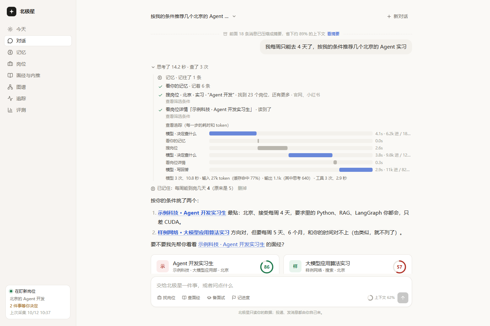
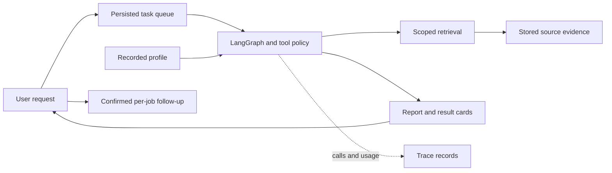

# Polaris

[中文](README.md) · [Current acceptance status](docs/LOCAL_ACCEPTANCE.md)

Polaris is a local job-search workbench for LLM and Agent internships: find jobs and interview material, compare requirements with the user's recorded background, prepare answers, and save explicitly confirmed follow-ups. It keeps source evidence and model/tool traces.

**The current local release has not passed end-to-end acceptance.** There is no hosted demo or deployed continuous cloud agent. Collectors and services require an explicit manual start; project autostart is disabled. The author uses this project for internship preparation and is developing it toward a hackathon submission.



This historical screenshot illustrates the interface, not the current build's acceptance result. Historical evaluation numbers are scoped to their original experiments; see [the reports](eval/reports/) and [current status](docs/STATUS.md).

## What the implementation contains

- Source collection, extraction, job alignment and search infrastructure for personal use.
- A persisted chat-task queue, LangGraph orchestration, profile memory, tool limits and human approval for designated actions.
- Source-linked job/interview cards, eligibility conflicts and unknowns, interview preparation, and per-job follow-up records.
- Traces for calls, latency, tokens and known or unknown cost; cancellation and unconfirmed-delivery handling.

The independent demo uses only handcrafted synthetic jobs, interview text and a fictional profile. It uses PostgreSQL keyword retrieval; vector, graph, reranking, live platforms, external ingestion and MCP are disabled there. A public company name is an example label, not evidence of actual hiring or interview questions.



## Independent local demo

These are manual setup steps, **not a claim of a successful clean install**. Docker image pull, PostgreSQL migrations/import and a complete browser task are still unverified for this entry. The detailed, authoritative runbook is [DEMO.md](docs/DEMO.md); [ACCEPTANCE_RUNBOOK.md](docs/ACCEPTANCE_RUNBOOK.md) defines what must be checked afterwards.

Requirements: Python 3.12+, uv, Docker Compose and Node.js 20.9+ (the locked Next.js package's requirement). You need your own compatible model service and must account for its usage. The demo does not copy the author's database or browser sessions.

From a new PowerShell terminal in the repository root:

```powershell
uv sync --frozen
Copy-Item config/demo.env.example .env.demo
```

Edit `.env.demo` yourself: set a separate database password, a separate `OWNER_TOKEN`, and your provider's supported model configuration. The URL password and `DEMO_DB_PASSWORD` must agree. Keep credentials out of Git. Avoid inherited personal overrides for `DATABASE_URL`, `DEMO_MODE`, `POLARIS_API` and `OWNER_TOKEN`.

```powershell
$env:POLARIS_ENV_FILE = (Resolve-Path .env.demo).Path
uv run python -m polaris.demo
uv run python -c "from polaris.config import get_settings; from polaris.db.migration_config import migration_database_url; s=get_settings(); assert s.demo_mode; assert migration_database_url()==s.database_url; print('Demo configuration agrees; no database or model request performed.')"
```

The first command checks samples in memory. The second validates configuration, not provider availability. Only when you intend to start the independent demo:

```powershell
docker compose --env-file .env.demo -f compose.demo.yml up -d --wait db
uv run alembic upgrade head
uv run python -m polaris.demo --seed --apply
uv run polaris serve --port 8010
```

Use another new terminal at the repository root for the web app:

```powershell
$env:POLARIS_ENV_FILE = (Resolve-Path .env.demo).Path
$env:POLARIS_API = 'http://127.0.0.1:8010'
npm --prefix web ci
npm --prefix web run dev -- -H 127.0.0.1 --port 3010
```

Open `http://127.0.0.1:3010`. Verify the synthetic banner and `/health` reporting `config.dataset=synthetic_demo`. The demo proxy also checks health before authenticated forwarding; a mode mismatch or unavailable demo blocks the request. Restart the corresponding process after changing its configuration.

Stop the API and web terminals with Ctrl+C, then stop the independent database while retaining its volume:

```powershell
docker compose --env-file .env.demo -f compose.demo.yml stop
```

Do not use the personal-data `polaris sandbox` copy for public recording. Demo source links under `example.invalid` are labels; inspect stored synthetic text in the app rather than treating them as live job pages.

## Evidence and limits

The latest scoped checks recorded 182 backend tests passing, three database tests deselected, and 17 isolated web configuration/proxy tests passing. These include in-memory graphs, stubbed fetch and limited ASGI requests. They do not prove a working browser flow or current PostgreSQL behavior. Fourteen migrations rendered offline SQL; none were applied in that check.

- [Fixture source facts](eval/reports/demo-fixture-facts-20261024.json): deterministic synthetic data, not an agent answer or a ranking benchmark.
- [Report delivery case](docs/design/REPORT_DELIVERY.md): generated output, saved conversation and user delivery are separate states.
- [Demo configuration and migrations](docs/research/2026-10-24-demo-config-and-migrations.md).
- [Demo proxy dataset checks](docs/research/2026-10-24-demo-api-identity.md).
- [Two-minute recording script](docs/DEMO_RECORDING.md): a plan, not a recorded video.

## NVIDIA, Nebius and deployment status

The model layer accepts configurable OpenAI-compatible providers. Isolated development probes have used a temporary Bailian configuration; this is not evidence of current NVIDIA/Token Factory execution. Example endpoint/model strings alone do not establish provider integration.

A verified NVIDIA model run, Token Factory/Nebius usage evidence, hosted access and submission materials remain pending. [Competition notes](docs/HACKATHON.md) are historical and must be rechecked against official rules before submission. Continuous cloud monitoring also requires an agreed execution environment, persistent storage, source coverage, operating budget and maintenance responsibility; no cloud resources have been purchased or deployed for it.

## Authorship and license

Developed by [duoduo-cell](https://github.com/duoduo-cell). Licensed under [Apache-2.0](LICENSE). Third-party platform originals, cookies, private conversations and credentials are excluded from public demo material.
