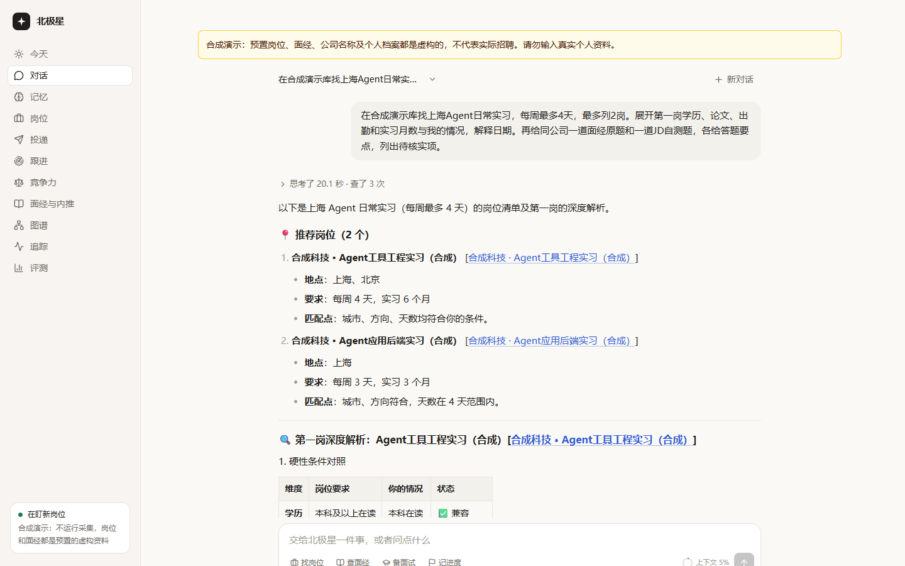
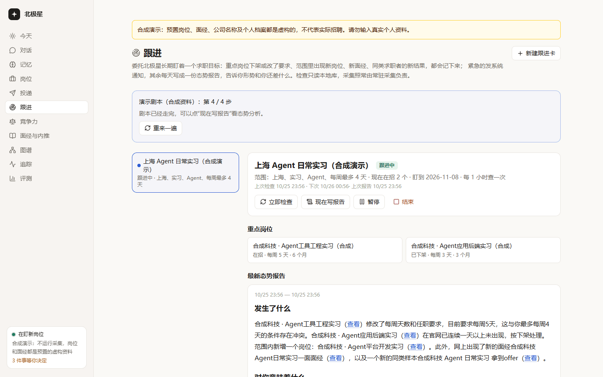
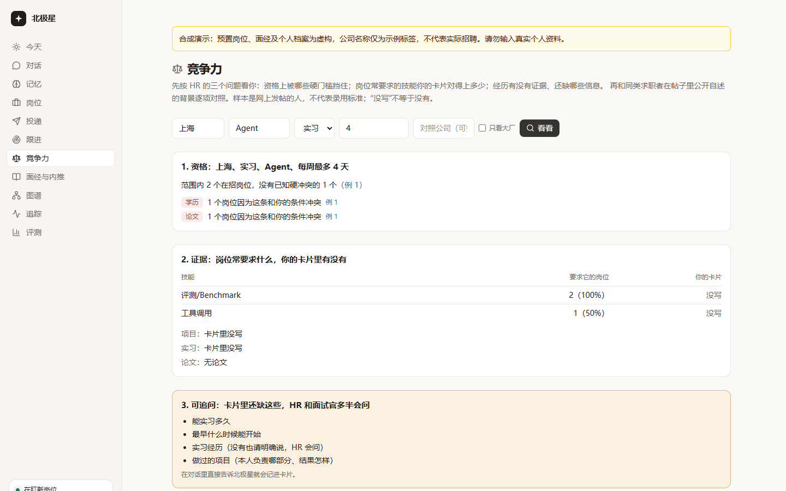
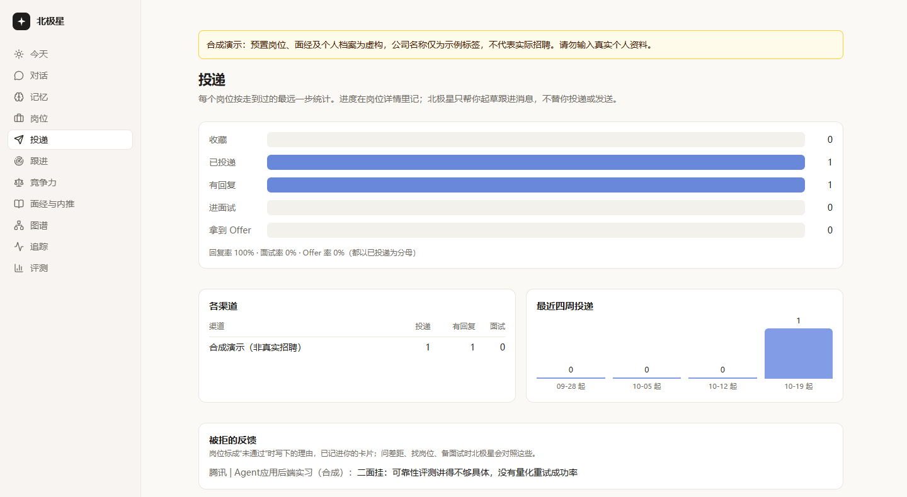
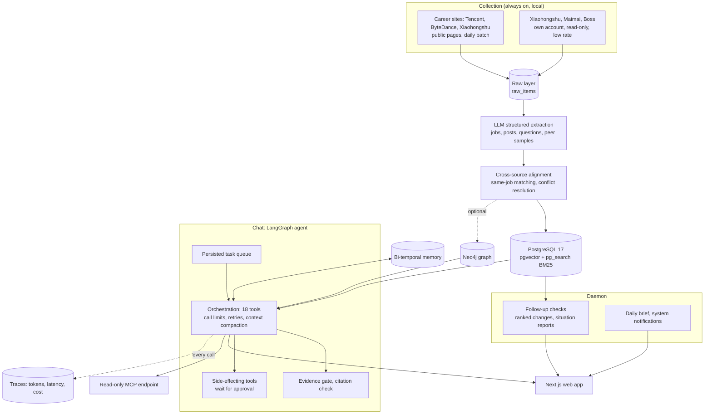
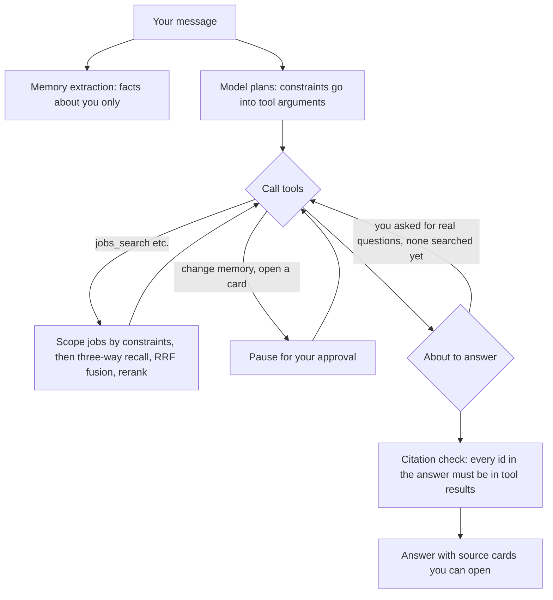

# Polaris

[中文](README.md) · [Synthetic demo](docs/DEMO.md) · [Design](docs/TECH.md) · [Dev log (Chinese)](docs/DEVLOG.md)

**A job-search agent for people looking for LLM and Agent internships in China.** It keeps collecting jobs and interview write-ups from company career sites, Xiaohongshu and Maimai, searches them against your constraints (city, direction, days per week, how many months you can stay), marks every hard conflict between you and a job, pulls real interview questions out of real posts, and watches a search goal for you over weeks. Every claim it makes opens to the source text; when it finds nothing, it says so.

The author uses it for their own internship search. It is also their entry to the Nebius × NVIDIA Global AI Hackathon, Personal AI track. The interface and the documents are in Chinese, because the users and the sources are.

All screenshots come from the [synthetic demo](docs/DEMO.md): jobs, interview posts, company names and the profile are all invented.

## What it does

| | What | Why you can trust it |
|---|---|---|
| **Find jobs** | Search by city, direction, internship type and days per week; keyword, vector and knowledge-graph recall, fused and reranked | Constraints filter before recall; a constraint the posting does not state is marked "to confirm", never counted as a match |
| **Check fit** | Education, papers, attendance and internship length compared with your memory card | Hard conflicts are flagged; whatever your card lacks is listed as "information to add" |
| **Interview questions** | Questions extracted from posts, with source and post date | When you ask for real questions, orchestration forces a question search first; any id the answer cites must appear in tool results, or the page marks it unverified |
| **Follow-up cards** | Watch one goal over time: a focus job removed or changed, new jobs in scope, new interview posts, new outcomes from people like you | Reads the local database only, deduplicated by fingerprint; changes ranked urgent / digest / quiet; a daily situation report whose facts are computed by rules first and only written by the model |
| **Competitiveness** | The three questions HR asks: which hard requirements block you, how many common skills your card covers, whether your experience has evidence; then a three-tier comparison with people who posted their own background | Says so when the sample is small; "not written" is not "does not have" |
| **Applications** | Funnel from saved to offer, channels, weekly volume; drafts follow-up messages | Drafts only, never sends; placeholders where the card has no information, never "meets the requirement" |
| **Memory** | Remembers what you said about your constraints and experience; viewable, with history, deletable | Bi-temporal (true when / learned when); asks before overwriting; since 10-25, constraints inside a question are not stored as facts about you |
| **Safety** | Outside text is marked untrusted; changing data or opening a follow-up card waits for your approval | Approve or reject only; arguments cannot be edited and then executed |

<table>
<tr>
<td></td>
<td></td>
</tr>
<tr>
<td align="center">Follow-up card: in the demo script, days 4→5, a removed job, a new job and a new interview post are all caught and reported</td>
<td align="center">Competitiveness: 1 of 2 open jobs conflicts on education and papers; evaluation/benchmark is required by both and missing from the card</td>
</tr>
</table>

 Applications: the funnel counts the furthest step each job reached; a rejection reason goes into the card and is used when you ask what to improve

## Architecture

One request through the agent:

## Engineering cases

All of these came from running the whole system for real. No offline test caught any of them.

| Symptom | Cause | Fix | Before → after |
|---|---|---|---|
| "Beijing Agent internship" listed 1 job | The search took the top 50 chunks from the whole corpus and only then intersected with the user's scope: 40 in-scope candidates became 1 (post-filtering losing recall). Also, 140 of 207 Beijing internships did not state days per week and were dropped | Pass the in-scope job ids into all three recall paths (filter first, then rank); keep jobs with unknown days and mark them "to confirm" | Candidates 1 → 32 |
| One task took 265 s while the model paged through results | Tool output was capped at 6,000 characters and each job took about 2,200, so a page held 1–2 jobs | Drop the threshold explanations repeated on every list item (details keep them); raise the cap to 16,000 characters | Fewer pages; with the next two fixes the full task took 77 s |
| Model requests failed with "connection error" after 30 s | A local accelerator's TUN interface captured traffic to Alibaba Bailian: handshakes took 1–8 s and often hung, while direct Wi-Fi connections succeeded 6/6 in about 0.2 s | [`llm/direct.py`](src/polaris/llm/direct.py): only for the Bailian host and only when system DNS returns a 198.18/15 fake address, resolve the real address through Alibaba DNS and connect from the default-route interface; fall back to the tunnel on failure | jobs_search 103 s → 2 s, zero failed model requests |
| The answer said "I found an interview question in the database"; there was none | The model finished without calling the question search, despite a prompt rule against inventing questions | [`QuestionEvidenceGate`](src/polaris/agent/final_answer.py) in orchestration: when the user asks for real questions and no question search has succeeded, route back to search first | Questions come from real posts with source and date; no unverified-citation warning |
| Setting up CI showed tests "passing" with no database | `conftest.py` skipped every database test when the test database was unreachable, exit code 0. On 10-25 Docker had stopped and 306 of 792 tests never ran | Fail instead of skip in CI; CI uses the same ParadeDB image as the demo | [PR #2](https://github.com/duoduo-cell/polaris/pull/2) |

The first four are in commit [`1d8cf59`](https://github.com/duoduo-cell/polaris/commit/1d8cf59); the [dev log](docs/DEVLOG.md) entry for the evening of 10-24 records the runs. See also the [report delivery case](docs/design/REPORT_DELIVERY.md): why "generated" is not "saved".

## Evaluation

Module evaluations from 10-11 to 10-13. Each number holds for that version and question set only, not for today's end-to-end tasks.

| Area | Result | Report |
|---|---|---|
| Retrieval | NDCG@10: single path 0.73 → three paths 0.81 → with rerank 0.89 | [M4](eval/reports/M4.md) |
| Cross-source alignment | Test set F1 0.93 (labelled after the rules were frozen, evaluated only) | [M4](eval/reports/M4.md) |
| Memory | Exact sentence match: dev 26/28, held-out 14/16, test 13/16 | [M5](eval/reports/M5.md) |
| Tool calling | 14 tasks, pass^3 100% | [M2](eval/reports/M2.md) |
| Answer quality | Dev 24/24 and 23/24 (two databases), held-out 13/14, zero fabricated sources | [dev](eval/reports/answers.md), [held-out](eval/reports/answers_v2.md) |
| Prompt injection | 0 of 15 attacks succeeded | [injection](eval/reports/injection.md) |

Tests: 801 backend tests, web type check, ESLint, unit tests and build run on every PR in [CI](.github/workflows/ci.yml). Seven replay cassettes contain Xiaohongshu text and run only on the author's machine.

## Data boundaries

- **Public career pages**: collected normally, daily.
- **Xiaohongshu, Maimai, Boss**: only on the author's machine, with the author's own account, read-only and low-rate. No fingerprint spoofing, proxy pools, account rotation or captcha bypass; on a verification prompt it stops and waits for a person. Raw text never enters this repository, the public demo or the submission.
- **No people collection**: no Maimai or LinkedIn profiles, no automated messages, no automated applications.
- **Public demo**: handwritten synthetic data only, with its own database, API and web app; the web app checks before every request that it is talking to the demo API.

The author's local database as of 10-25: about 690 jobs, 2,400 posts, 3,800+ interview questions, and 11,000+ recorded model calls.

## Run it

You need Python 3.12 with [uv](https://docs.astral.sh/uv/), Node.js 24, Docker and an OpenAI-compatible model endpoint.

- **Synthetic demo**: follow [docs/DEMO.md](docs/DEMO.md): separate database, API on 8010 and web app on 3010, seeded from an empty database.
- **Personal instance** (Windows): create `.env` from [`.env.example`](.env.example), then run `.\scripts\up.ps1`. It starts the database, API (8000), web app (3000) and the collection daemon in the background and skips whatever is already running.
- **Development**: see [CONTRIBUTING.md](CONTRIBUTING.md); the commands match CI.

## Stack

| Layer | Used |
|---|---|
| Agent | LangGraph 1.2 / LangChain 1.4: middleware for approval, call limits, retries and evidence gates; Postgres checkpointer |
| Retrieval | PostgreSQL 17 + pgvector + ParadeDB pg_search (BM25 with Chinese tokenization); Neo4j graph (optional); weighted RRF, rerank, MMR |
| Backend | FastAPI, SQLAlchemy 2.1, Alembic, MCP (streamable HTTP, bearer token) |
| Web | Next.js 16, React 19, installable on a phone (PWA) |
| Collection | Playwright with a dedicated browser profile, read-only platform tools |
| Models | Alibaba Cloud Bailian: chat qwen3.7-plus, extraction qwen-plus, embeddings text-embedding-v4, rerank qwen3-rerank; another provider is a `.env` change |
| Engineering | pytest against real Postgres, ruff, GitHub Actions; every model call records tokens, latency and cost |

## Hackathon note

Built for the Nebius × NVIDIA Global AI Hackathon, Personal AI track. **This entry runs on Qwen models through Alibaba Cloud Bailian. It does not use Nebius Token Factory or an NVIDIA model.** The model layer speaks the OpenAI-compatible API, so pointing `.env` at Token Factory is a configuration change ([`.env.example`](.env.example) has a commented block), but that path has not been run. The author chose not to set up Nebius billing and accepts that the entry does not meet those two requirements.

## Known limits

- How fast a follow-up card sees a change depends on collection frequency: career sites once a day, logged-in platforms at a low daytime rate.
- Peer samples are sparse; for a specific company and direction there are often only a handful, so comparisons are case-level.
- Boss rejects the session token from time to time and needs the owner to log in again.
- Nobody is told when the database goes down ([#5](https://github.com/duoduo-cell/polaris/issues/5)); the demo reset does not restore memory ([#12](https://github.com/duoduo-cell/polaris/issues/12)).
- Launch scripts exist for Windows only; CI covers tests and builds, but nobody has done a clean install on another machine yet.

## Docs (Chinese)

- [PURPOSE](docs/PURPOSE.md): why and the roadmap
- [TECH](docs/TECH.md), [design/](docs/design/): design, including [follow-up cards](docs/design/WATCH.md)
- [STACK](docs/STACK.md): technology choices; [DATASET](docs/DATASET.md): sources, rates and account boundaries
- [HIRING](docs/HIRING.md): 352 Agent job requirements and 902 interview write-ups, which decided what to build
- [research/](docs/research/): dated research; [archive/](docs/archive/): superseded plans
- [STATUS](docs/STATUS.md): where things stand; [DEVLOG](docs/DEVLOG.md): what each round ran into and changed

## License

[Apache-2.0](LICENSE). Developed by [duoduo-cell](https://github.com/duoduo-cell).
