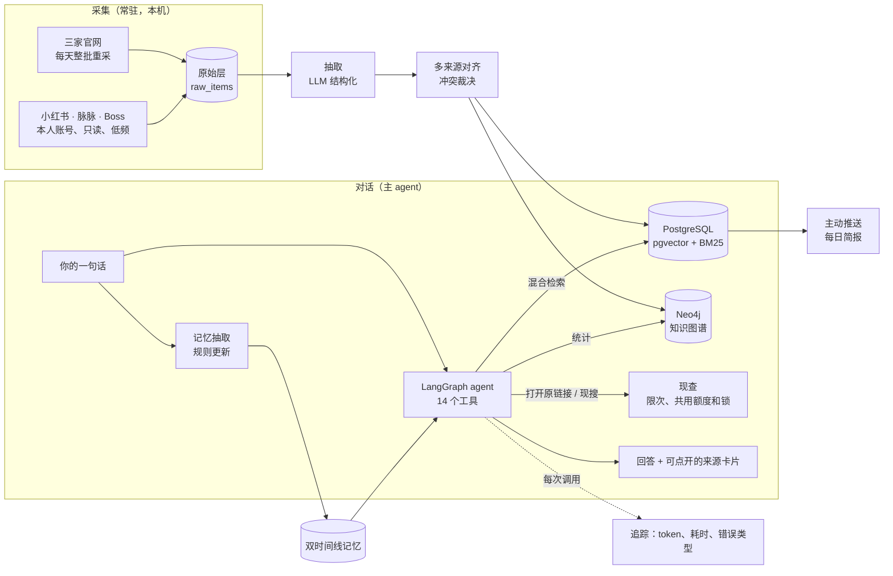

# Polaris（北极星）

一个本机求职工作台：围绕 LLM / Agent 实习条件查岗位和面经、对照个人要求、准备面试并保存确认的跟进，保留来源和工具记录。采集与网页需要使用者手动启动，当前不随开机自行运行。为 Nebius × NVIDIA Global AI Hackathon 开发，也是作者自己找实习用的工具。


**指标适用范围（2026-10-13）**：下文旧题集、模块及探针数字仅说明对应历史版本，不能宣称当前真实任务整体通过，也不作为后续研发清单。最新状态见 [STATUS.md](docs/STATUS.md)。

**开发接续（2026-10-21）**：先读 [HANDOFF](docs/HANDOFF.md) 与 [当前路线](docs/PURPOSE.md)，完整 [GitHub 对标和项目审计](docs/research/2026-10-21-github-and-project-audit.md) 已保存。当前候选尚未整体验收/部署；本机沙盒是真实数据副本，公开演示需要独立合成数据。

## 三分钟看懂（每个数字都能点开核实）

| 方面 | 做了什么 | 指标 | 报告 |
|---|---|---|---|
| 检索 | BM25（中文分词）+ 向量 + 知识图谱三路召回，加权 RRF、重排、MMR | NDCG@10：单路 0.73 → 三路 0.81 → 加重排 0.89 | [M4](eval/reports/M4.md) |
| 多来源对齐 | 同岗识别、冲突裁决并保留各处说法 | 测试集（规则冻结后标注、只评不调）F1 0.93 | [M4](eval/reports/M4.md) |
| 记忆 | 双时间线、模型抽候选、规则做决定、改口要确认 | 整句全对：开发 26/28、留出 14/16、测试 13/16 | [M5](eval/reports/M5.md) |
| 工具调用 | 参数校验返回"怎么改"、故障注入恢复、重复调用复用、每种工具上限、查满 10 次提醒收尾、检索服务出错时降级 | 工具调用套件 14 题 pass^3 100%；回答评测里单题最多调用 27 → 12–14 次 | [M2](eval/reports/M2.md)、[DEPTH](docs/design/DEPTH.md) |
| 回答质量 | 开发集 24 题 + 留出集 14 题（正常、边界、对抗）；规则检查 + 另一家模型按依据、深度、具体、诚实打分 | 开发集 24/24、23/24（两个库各跑一次），留出集 13/14；编造来源 0；四项平均 4.6–4.75 / 3.9–4.25 / 4.3–4.6 / 4.5–4.75 | [开发集](eval/reports/answers.md)、[留出集](eval/reports/answers_v2.md) |
| 安全 | 外部原文不可信标记、改数据要批准、对外动作只起草 | 15 次注入攻击 0 次得逞 | [injection](eval/reports/injection.md) |
| 排错 | 四轮真实问答探针 + 七个版本的回答评测，记下失败类别（含评测器自己的错）和改动；留出集抓到过拟合后撤回 | 上下文压缩 14 → 0 次，最慢回答 365 → 148 秒 | [DEPTH](docs/design/DEPTH.md) |

为什么是这些指标：[docs/HIRING.md](docs/HIRING.md)（大厂 352 个 Agent 岗位要求 + 902 道亲历面经的统计）。

## 架构



## 本地运行

当前第一阶段尚未完成完整任务与独立交付验收。新增[纯合成演示候选](docs/DEMO.md)使用独立配置和独立数据库；已有离线检查，但尚未执行该入口的容器启动、实际导入和网页验收。不要将下方真实数据沙盒用于公开展示。

需要 Docker、[uv](https://docs.astral.sh/uv/)、Node.js。`.env` 自己建（模型服务的地址、key、模型名，见 `.env.example`）。

```powershell
.\scripts\start.ps1 -Sandbox   # 起数据库、API（8000）和网页（3000），用沙盒库，不碰真实记忆
```

```bash
uv run pytest                          # 后端测试
uv run polaris metrics answers --fresh # 回答质量评测（在隔离库上跑）
```

详细的使用和测试教程：[docs/GUIDE.md](docs/GUIDE.md)。

## 文档

- [docs/PURPOSE.md](docs/PURPOSE.md)：为什么做
- [docs/HIRING.md](docs/HIRING.md)：大厂看什么，北极星怎么证明
- [docs/INTERVIEW.md](docs/INTERVIEW.md)：讲法、简历条目、高频追问
- [报告交付工程案例](docs/design/REPORT_DELIVERY.md)：生成与保存状态分开、未知状态不自动重复；含失败／修复证据和合成模型回放，未替代网页整体验收
- [docs/TECH.md](docs/TECH.md)、[docs/design/](docs/design/)：技术方案和各模块设计
- [docs/STATUS.md](docs/STATUS.md)：进度
- [eval/reports/](eval/reports/)：各模块指标

数据说明：小红书、脉脉、Boss 的原文只在作者本机，不进仓库和公开演示；截图里的岗位是合成的示例。

## 许可证

Apache-2.0，见 [LICENSE](LICENSE)。
