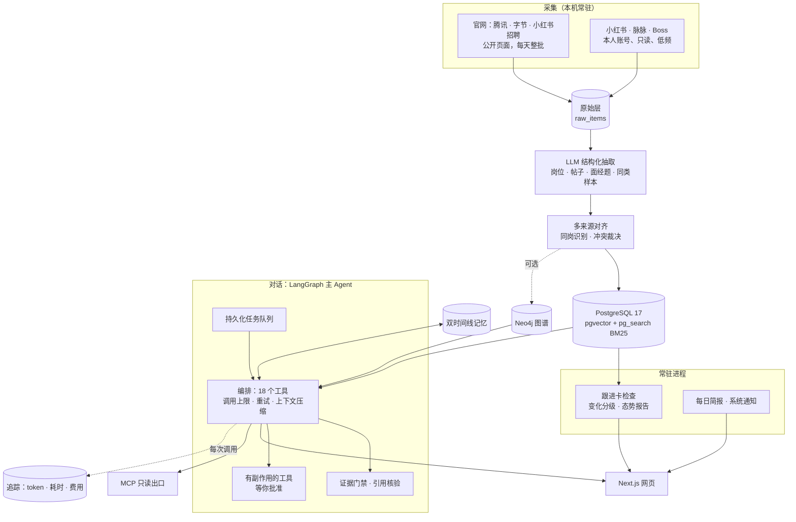
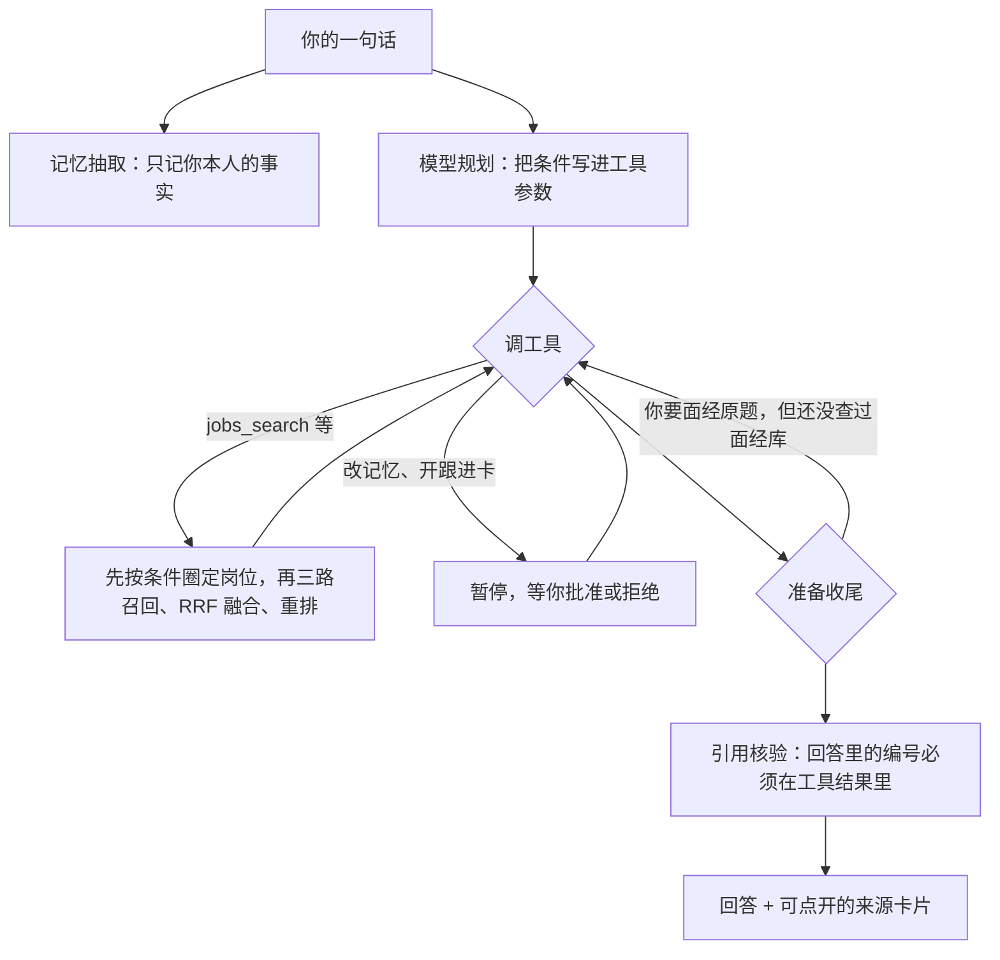

# Polaris（北极星）

[English](README.en.md) · [合成演示](docs/DEMO.md) · [技术方案](docs/TECH.md) · [研发日志](docs/DEVLOG.md)

**给找 LLM / Agent 实习的人用的求职 Agent。** 它常驻采集官网、小红书、脉脉上的岗位和面经，按你的条件（城市、方向、每周几天、能实习多久）查岗位，标出你和每个岗位的硬冲突，从真实帖子里找面试原题，替你长期盯着一个求职目标。它说的每一条都能点开看到来源原文；查不到的，就说查不到。

作者自己找实习时就在用它，它也是作者参加 Nebius × NVIDIA Global AI Hackathon（Personal AI 赛道）的作品。

截图全部来自[合成演示](docs/DEMO.md)：岗位、面经和个人档案都是虚构的，公司名只是示例标签。

## 能做什么

| | 做什么 | 怎么保证可信 |
|---|---|---|
| **找岗位** | 按城市、方向、实习类型、每周天数查岗位；关键词、向量、知识图谱三路召回后融合、重排 | 先按条件筛再召回；岗位没写的条件标“待确认”，不算符合 |
| **对照条件** | 学历、论文、出勤、实习时长逐项和你的记忆卡片对照 | 硬冲突单独标出；卡片没写的列为“要补充的信息” |
| **面经** | 从帖子里抽出的面试原题，带出处和发帖日期 | 你要原题时，编排层强制先查面经库；回答里引用的编号必须出现在工具结果里，否则页面标“未核验” |
| **跟进卡** | 长期盯一个目标：重点岗位下架或改了要求、范围里的新岗位、新面经、同类求职者的新结果 | 只读本地库、按指纹去重；变化分成紧急、进简报、安静三档；每天写一份态势报告，事实由规则先算好，模型只负责写 |
| **竞争力** | 用 HR 的三个问题看你：被哪些硬门槛挡住、常见技能你的卡片对上多少、经历有没有证据；再和公开自述的同类求职者三层对照 | 样本少就直说；“没写”不等于“没有” |
| **投递** | 收藏 → 投递 → 回复 → 面试 → Offer 漏斗、各渠道、每周投递量；起草跟进消息 | 只起草不发送；卡片里没有的信息留占位，不替你写“满足要求” |
| **记忆** | 记住你说过的条件和经历，能看、能查历史、能删 | 双时间线（何时成立 / 何时得知）；改口先确认；10-24 起查询里的条件不再记成你本人的事实 |
| **安全** | 外部原文标为不可信；改数据、开跟进卡这类有副作用的操作要你批准 | 只能批准或拒绝，不能改了参数再执行 |

<table>
<tr>
<td></td>
<td></td>
</tr>
<tr>
<td align="center">跟进卡：演示剧本里天数 4→5、岗位下架、新岗位、新面经，全部被发现并写进报告</td>
<td align="center">竞争力：2 个在招岗位中 1 个有硬冲突（学历、论文），评测/Benchmark 两个岗位都要求但卡片里没写</td>
</tr>
</table>

 投递：按每个岗位走到的最远一步算漏斗；标“未通过”时写的理由记进卡片，之后问差距会对照

## 架构

一次请求在 Agent 里怎么走：

## 工程案例

都来自把系统真实跑起来时遇到的问题，离线测试一个都没发现。

| 现象 | 原因 | 改法 | 前后 |
|---|---|---|---|
| “北京 Agent 日常实习”只列出 1 个岗位 | 先在全库取前 50 个文本块，再和条件范围取交集，范围内 40 个候选只剩 1 个（检索里典型的后过滤丢召回）；另外北京实习 207 个里有 140 个没写每周天数，被整批排除 | 把范围内的岗位编号传进三路召回，先筛后排；没写天数的保留并标“待确认” | 召回候选 1 → 32 |
| 一次任务 265 秒，模型在一页页翻结果 | 工具结果上限 6000 字，每个岗位约 2200 字，一页只放得下 1～2 个 | 列表里去掉每条都重复的门槛长解释（详情里仍有），上限放到 16000 字 | 少翻页；加上下面两项，完整任务降到 77 秒 |
| 模型请求 30 秒后“连接错误” | 本机加速器的 TUN 把百炼流量也接管了，握手 1～8 秒、经常卡住；同一时刻网卡直连 6/6 成功，约 0.2 秒 | [`llm/direct.py`](src/polaris/llm/direct.py)：只对百炼域名，而且只在系统 DNS 返回 198.18/15 假地址时，向阿里 DNS 查真实地址并从默认路由网卡直连，失败就退回隧道 | jobs_search 103 秒 → 2 秒，模型请求 0 失败 |
| 回答写“我在库里找到了一道面试题”，库里根本没有 | 模型没调面经检索就直接收尾；提示词里早就写了不许编原题，它照样跳过 | 在编排层加 [`QuestionEvidenceGate`](src/polaris/agent/final_answer.py)：你要原题、对话里又没有成功的面经检索时，退回去先查 | 面经题都来自真实帖子，带出处和日期，没有“未核验”警告 |
| 第一次配置 CI 时发现：数据库没起，测试照样“通过” | 连不上测试库时 conftest 直接跳过所有数据库测试，退出码仍是 0；10-25 Docker 停了一上午，792 项里有 306 项没跑 | CI 里连不上库就失败；CI 用和演示同一个 ParadeDB 镜像 | 见 [PR #2](https://github.com/duoduo-cell/polaris/pull/2) |

前四项在提交 [`1d8cf59`](https://github.com/duoduo-cell/polaris/commit/1d8cf59)，过程记录在 [DEVLOG](docs/DEVLOG.md) 10-24 晚那一节。另有一个[报告交付案例](docs/design/REPORT_DELIVERY.md)，讲为什么“生成成功”不等于“保存成功”。

## 评测

10-11 到 10-13 做的模块评测。数字只对当时的版本和题集成立，不代表当前整体任务的通过率。

| 方面 | 指标 | 报告 |
|---|---|---|
| 检索 | NDCG@10：单路 0.73 → 三路 0.81 → 加重排 0.89 | [M4](eval/reports/M4.md) |
| 多来源对齐 | 测试集 F1 0.93（规则冻结后标注，只评不调） | [M4](eval/reports/M4.md) |
| 记忆 | 整句全对：开发 26/28、留出 14/16、测试 13/16 | [M5](eval/reports/M5.md) |
| 工具调用 | 14 题 pass^3 100% | [M2](eval/reports/M2.md) |
| 回答质量 | 开发集 24/24 和 23/24（两个库各跑一次），留出集 13/14，编造来源 0 | [开发集](eval/reports/answers.md)、[留出集](eval/reports/answers_v2.md) |
| 提示注入 | 15 次攻击 0 次得逞 | [injection](eval/reports/injection.md) |

测试：后端 792 项、网页类型检查、ESLint、模块测试和构建，每个 PR 都由 [CI](.github/workflows/ci.yml) 跑一遍。其中 7 段回放录像含小红书原文，只在作者本机跑。

## 数据边界

- **官网公开岗位**：正常采集，每天整批。
- **小红书、脉脉、Boss**：只在作者本机、用本人账号，只读、低频；不伪造指纹、不用代理池、不轮换账号、不绕过验证码，遇到验证就停下等人处理。原文不进仓库、公开演示和提交材料。
- **不采人**：不抓脉脉、LinkedIn 的个人主页，不自动发消息、不自动投递。
- **公开演示**：只用手写的合成资料，和个人实例用不同的数据库、API 和网页；网页每次转发前都确认对面是演示 API。

作者本机库到 10-25 的规模：约 690 个岗位、2400 篇帖子、3800 多道面经题，记录了 1.1 万多次模型调用。

## 运行

需要 Python 3.12 + [uv](https://docs.astral.sh/uv/)、Node.js 24、Docker，以及一个 OpenAI 兼容的模型服务。

- **合成演示**：按 [docs/DEMO.md](docs/DEMO.md)，独立数据库 + API（8010）+ 网页（3010），从空库导入合成资料。
- **个人实例**（Windows）：`.env` 自己建（参照 [`.env.example`](.env.example)），然后运行 `.\scripts\up.ps1`，会在后台起数据库、API（8000）、网页（3000）和常驻采集，已经在跑的会跳过。
- **开发和测试**：见 [CONTRIBUTING.md](CONTRIBUTING.md)，命令和 CI 一致。

## 技术栈

| 层 | 用了什么 |
|---|---|
| Agent | LangGraph 1.2 / LangChain 1.4：中间件做审批、调用上限、重试、证据门禁；Postgres checkpointer |
| 检索 | PostgreSQL 17 + pgvector + ParadeDB pg_search（BM25，中文分词）；Neo4j 图谱（可选）；加权 RRF、重排、MMR |
| 后端 | FastAPI、SQLAlchemy 2.1、Alembic、MCP（streamable HTTP，带口令） |
| 网页 | Next.js 16、React 19，可装到手机（PWA） |
| 采集 | Playwright（专用浏览器配置）、各平台只读工具 |
| 模型 | 阿里云百炼：对话 qwen3.7-plus，采集抽取 qwen-plus，向量 text-embedding-v4，重排 qwen3-rerank；换别家只改 `.env` |
| 工程 | pytest（带真实 Postgres）、ruff、GitHub Actions；每次模型调用都记录 token、耗时和费用 |

## 已知局限

- 跟进卡发现变化的速度取决于采集频率：官网每天一批，登录平台只在白天低频采。
- 同类样本稀疏，具体到“某公司 + 某方向”往往只有个位数，对照只能看个例。
- Boss 的令牌会被平台拒绝，需要本人重新登录。
- 数据库停了不会有人通知（[#5](https://github.com/duoduo-cell/polaris/issues/5)）；演示的“重来一遍”不恢复记忆（[#12](https://github.com/duoduo-cell/polaris/issues/12)）。
- 启动脚本只写了 Windows 版；CI 覆盖了测试和构建，但还没在别人的电脑上从零装过一遍。

## 文档

- [PURPOSE](docs/PURPOSE.md)：为什么做、路线
- [TECH](docs/TECH.md)、[design/](docs/design/)：技术方案和模块设计，含[跟进卡](docs/design/WATCH.md)
- [STACK](docs/STACK.md)：选型理由；[DATASET](docs/DATASET.md)：数据源、频率和账号边界
- [HIRING](docs/HIRING.md)：352 个 Agent 岗位要求和 902 道面经的统计，决定了做什么
- [research/](docs/research/)：带日期的调研；[archive/](docs/archive/)：被取代的旧规划
- [STATUS](docs/STATUS.md)：现在做到哪；[DEVLOG](docs/DEVLOG.md)：每一轮遇到什么、怎么改的

## 许可证

[Apache-2.0](LICENSE)
