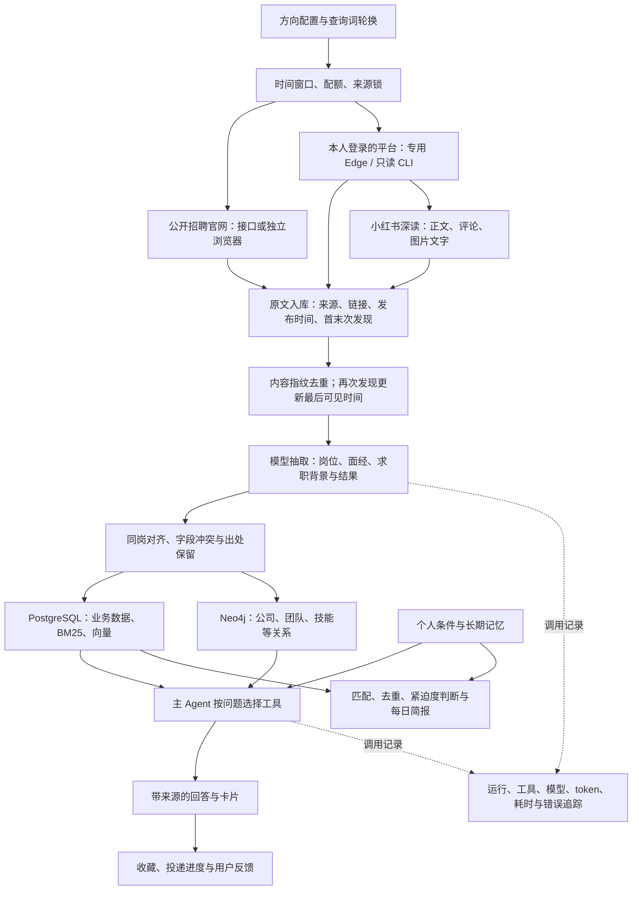

# 北极星采集流程与运行核查（2026-10-20）

历史流程及运行快照。接手时以 [HANDOFF](HANDOFF.md) 和只读实际核查为准，本文旧进程/登录状态不触发重启或重复补采。

这是当前项目采集系统的说明与本轮核查记录。平台状态、数量是带时间的快照；采集进程仍会继续运行。它不代表所有互联网信息已覆盖，也不代表所有模型回答都已通过验收。

## 实际覆盖范围

目前运行的是六个已实现来源：腾讯招聘官网、字节日常实习官网、小红书招聘官网，以及作者本人登录的小红书、脉脉、Boss 直聘。没有把尚未接入的牛客、LinkedIn 或其他公司官网算进本轮覆盖。

查询方向来自 config/directions.toml：Agent、大模型、RAG、LLM、AI 应用。官网按方向搜索；内容平台还会组合公司、实习、面经、内推、offer 背景等关键词。查询词存在数据库，每轮优先选择没有搜索过或最久没搜索的词。新发现的说法经校验后进入轮换。

## 从信息到可用答案

1. **先采原文。** 每拿到一条就写入 raw_items；中途退出不应丢失已经提交的原文。相同来源、相同内容不重复插入，重新遇到时更新最后一次看到的时间。“今天新增”和“今天再次看到”是两个数字。
2. **再抽结构化信息。** 岗位进入 postings；面经与经验帖进入 posts，背景与结果另有结构化记录。抽不到的字段保留未知。模型调用统一记录；非法 JSON 可请求修正，连接失败可有限重试，最终失败留待后续处理。
3. **把结构化记录变成知识库。** 同岗对齐后生成 jobs；保留来源与冲突。正文切块后更新 BM25、向量和图谱。正文不变的块无需重复计算向量。
4. **按个人条件使用知识。** 对话工具做结构化筛选、关键词/向量/图谱召回、融合与重排，回答附来源。采集本身不等于推荐，也不证明某个岗位适合作者。
5. **形成反馈。** 记录收藏、投递状态、跟进和回答反馈；主动简报结合条件、信息新颖度和截止紧迫度决定是否提示。

## 调度实际怎么运行

scripts/run_daemon.ps1 等数据库可用后启动 polaris daemon，日志写入 data/logs/daemon.log。一个常驻进程通过文件锁避免重复启动。

- 官网在每天 09:00 后尝试批量刷新；每个方向目前最多取配置的三页。它不是全站无限翻页。
- 官网阶段之后，常驻任务依次检查脉脉、Boss、小红书，满足时间、每日余额和每小时余额才采一轮。
- 小红书新轮次窗口为北京时间 09:00–23:00；脉脉和 Boss 为 09:00–22:00。一轮已启动后可能跨过窗口结束时点。
- 本日核查时计算出的平台日额度为：小红书 200 次、脉脉 150 次、Boss 200 次；不是“条数”。小红书另有每小时 60 次上限，页面操作间隔按配置保持 15–40 秒。
- 小红书按近半年与多种排序轮换；每篇最多处理 9 张图、80 条评论。脉脉按时间读取近半年的内容；Boss 按配置搜索四个城市的实习和公司规模。
- 同一来源共用锁，常驻采集与临时核查避免争用同一个来源。平台出现验证、频繁或登录失效时停止对应轮次，不把它当成“没有岗位”。
- 当前采集仍在本机运行；没有在本轮部署云端演示，也没有切换到比赛模型。

## 本轮已核实的运行证据

- Docker 中 PostgreSQL、pgvector、pg_search、Neo4j 恢复可用；常驻采集有实际新运行记录和写入。
- 字节完成一轮 542 条结果观察，新写入 21 条原文。最初 20 条抽取成功，剩下的一条已在补处理批次保存。
- 脉脉首个小批次超时后，正常页面操作与后续采集返回内容；常驻轮次新写入 33 条，完成 43 条结构化抽取（包含历史积压），不能把两组数字当作一一对应。
- Boss 最初 3 次只读调用新写入 2 条；两条已完成结构化抽取。19:20 后续请求提示 __zp_stoken__ 过期，需要作者在专用 Boss 窗口刷新；如果出现登录页，则由作者扫码。已经向作者发出操作请求，不能把缓存登录标记当作持续可用。
- 小红书小批次 4 次调用新写入 3 篇，读取了 14 张图片并保存 3 条评论；这三篇已补做结构化抽取。后续常驻深读仍在进行。
- 腾讯首次握手失败、第一次补采遇到读取超时；加入有限网络退避后重新补采，实际持续写入新岗位，结果以运行完成和最后快照为准。
- 小红书招聘官网能读取列表和一条 618 字岗位正文。第一次补采完成一个关键词后再次超时，已保留失败记录并使用调整后的导航等待继续补采；不能把部分成功写成整批完成。
- 关键词、向量和重排联合检索返回 3 个文本块，关键词与向量各召回 50 个候选；没有发生该次向量或重排降级。文本块数不等于不同岗位数。
- 一次短超时模型探针失败；真实任务里也有模型超时、JSON 校验失败和读图重试。最终成功、失败尝试和未处理记录分别统计，不报告虚假的整体成功率。

最新数据、待抽取数量及当前运行阶段见本机 data/probe/collection_snapshot_20261020.json。最后面向用户的数量使用报告时再次生成的快照，后续后台运行会继续增加。

### 19:29 北京时间快照

| 来源 | 今日新增原文 | 库内原文总数 | 待抽取（含历史） | 状态 |
|---|---:|---:|---:|---|
| 腾讯招聘官网 | 63 | 352 | 73 | 补采进行中 |
| 字节官网 | 21 | 343 | 0 | 本轮原文与抽取完成 |
| 小红书招聘官网 | 1 | 46 | 1 | 补采进行中；部分关键词已完成 |
| 小红书帖子 | 6 | 554 | 57 | 常驻深读进行中 |
| 脉脉 | 33 | 1,048 | 184 | 本轮采集与一批抽取完成，仍有历史积压 |
| Boss 直聘 | 2 | 4 | 0 | 已保存两条；后续令牌过期，待作者刷新 |

本日新增合计 126 条。现有 5,197 个文本块均已计算对应版本的向量，待算向量为零；这不包含尚未抽取、尚未形成文本块的原文。以上六来源原文汇总检查中，空正文、缺少来源链接均为零。今天最初三篇小红书已形成 13 个检索块，证明有一条真实新增数据从原文到可检索知识的完整路径；不外推为全量内容正确。

网页 3000 和 API 8000 本次没有启动。采集、后台抽取和知识层更新独立运行；不能从采集运行状态推断网页已经在线。

## 修复与验证

1. 腾讯只读 GET 的连接/读取异常现在最多重试两次，退避后再请求；HTTP 403、429 和业务拒绝立即结束，不用重试绕过限制。相关行为依据 [HTTPX 传输与重试说明](https://www.python-httpx.org/advanced/transports/) 和 [超时分类](https://www.python-httpx.org/advanced/timeouts/)。
2. 小红书招聘官网导航等待文档响应，随后仍等待岗位链接、职责和任职资格；导航超时有限重试，明确 HTTP 拒绝直接停止。没有降低正文完整性检查。依据 [Playwright 导航等待定义](https://playwright.dev/python/docs/api/class-page#page-goto)。
3. 原有 381 项后端回归在标准独立测试库上通过；新增 10 项网络与导航恢复、次数耗尽和拒绝不重试用例。最终全量 **391 passed，4 warnings，183.09 秒**，日志 data/probe/collection-20261020-regression-final.log；警告是既有 SQLAlchemy 数组查询弃用提醒。
4. Ruff、差异格式检查通过。既有前端卡片的三个未提交文件保持原状；不更改 .env、不推送远端。

修复已由本轮新启动的官网补采进程加载；原有常驻进程没有在采集中被重启，不能说它已经热加载了新代码。

## 仍需如实报告的限制

- **Boss 需要作者刷新或重新扫码。** 不代替作者处理登录或验证。
- **模型服务有波动。** 一次失败的调用不等于丢了一条原文；重试成功也不等于全部事实正确。读图最多处理的张数、正文截断和评论上限都限制覆盖深度。
- **旧数据有积压。** 常驻抽取按原文编号优先处理较早记录，每轮新数据数加十的处理量可能先落在旧积压上。因此新增原文不能直接算作当天已可检索的新知识。本轮对今天的 6 条漏抽记录单独补处理，没有宣称全部积压已清空。
- **失败的官网批次需要核查补采。** 现有调度将“今天尝试过”与“今天全部成功”混用，不能依赖进程存在证明失败来源自动补齐；本轮用明确的失败轮次编号补采并保留结果。
- **有一条旧运行记录仍标 running。** 它属于 10-14 的历史中断，不是仍在工作的第二个采集任务。本轮没有为了美化报告改写历史状态。
- **本轮只证明采集与知识处理的可运行性。** 不替代当前主 Agent 的完整真实任务验收，也不等于已经满足比赛提交条件。

原文、平台页面与登录态保留在本机忽略目录和私有数据库。公开报告只写汇总、行为与限制；不包含账号、密钥、聊天背景或平台原文。采集不会发消息、点赞或替作者投递。
