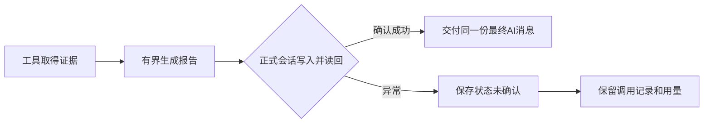

# 报告生成、会话保存与交付：工程案例

2026-10-24后续：任务停止收尾198f0d3及main-v37任务归属候选，已补未交付报告的下一轮／摘要输入检查。实际图／有限chat／内存ORM相邻152通过、3项数据库检查未选、0跳过；并非当前PG／网页通过。见[时序证据](../research/2026-10-24-task-cancellation.md)和[上下文交付边界](../research/2026-10-24-task-delivery-context.md)，旧无标签／非队列及部分并行工具停止仍有欠项。

2026-10-23，代码节点 `0cf7c7e`、`0b4a309`，追踪main-v36／career-report-v5，合成资料demo-fixture-v2。第一阶段仍未通过；本文提供可复查的子机制证据，不是网页或云端交付声明。

## 用户问题与具体失败

完整任务是按本次条件找岗、核对第一岗门槛与日期、给面经原题和JD自测题及各自要点，再保存用户确认的跟进。报告已有内部工具收尾，但工具生成文字和正式AI消息已保存是两件事。

在实际LangGraph图和内存checkpointer上，分别注入最终update_state写入失败、写入后get_state读回失败：两项原先都抛异常退出_run，绕过现有回答错误处理。这是离线故障注入，不是已观察到的真实PostgreSQL事故。此前正常持久保存路径的121项隔离集成证据不能覆盖这两个故障。

另外，演示第一版人工写入“星河演示科技”的题目公司注解，现有公司识别只支持既有词表，同题在帖子重解析中为未知。这是演示夹具绕开正常解析的差异，不能据此宣布真实平台归属普遍错误。

## 修改及边界

1. 演示v2使用公开公司名称“腾讯”作为显式示例标签；岗位、面经和档案仍是人工合成，与实际招聘无关。题目元数据从同一原文通过现有profile()产生，不再手填公司／轮次。没有在个人公司词表塞虚构公司或放宽来源校验。
2. 完整报告和生成失败的部分报告都保留合成说明，复制文字不再只依赖网页横幅。个人模式未标记合成的报告不因此加标签。
3. 工具生成后，正式消息写回及读回失败返回“最终会话保存未能确认”。不交付一份被当作已保存的成功回答，不抹掉已经发生的调用和用量，不自动重新生成；原始异常不发给用户。
4. 读回失败可能发生在写入已经成功之后，不能简单说保存肯定失败。重新连接用于核实，不是重新发一遍任务。停止仍优先返回停止，已执行工具及调用不伪装成未发生。



这里没有通用“恰好一次”保证，也不声称数据库中断可以自动续跑；数据库和网页实际故障验收仍欠缺。

## 修改前后证据

| 范围 | 修改前 | 修改后及局限 |
|---|---|---|
| 演示同题归属／独立文字说明 | 2项失败：人工公司注解与同文解析不同；报告离开横幅缺少合成开头 | 同一原文的题目注解、帖子和题目投影公司一致；题目轮次仍未知，标题保留一面／二面；完整和失败报告都有说明 |
| 最终会话异常 | 4项中正常保存／停止2项通过，写入／读回2项抛异常失败 | 4项均通过；写入失败时末条仍是ToolMessage，读回失败时末条已是AIMessage，两者均准确报告未确认 |
| 相邻离线集合 | 不把夹具错误算作产品错误 | 当前125通过、3项数据库检查未选、0跳过；Ruff通过。包含既有面经解析和实际LangGraph／内存checkpointer，不含当前版PG／网页运行 |
| 前端静态检查 | 旧横幅将公司名也称为虚构 | 已改为公司名称仅作示例；TypeScript、ESLint通过，未验证实际页面渲染 |

命令：

```powershell
.venv\Scripts\python.exe -X utf8 -m pytest tests/test_report_lifecycle.py tests/test_demo.py tests/test_config.py tests/test_search.py tests/test_matching_constraints.py tests/test_career_report.py tests/test_requirements_review.py tests/test_question_context.py tests/test_interviews.py -k 'not direct_report_is_saved and not matching_memory_date and not recent_search_excludes_updates' --junitxml=data/probe/report-lifecycle-and-demo-after-20261023.xml
```

失败XML为data/probe/demo-attribution-before-20261023.xml、report-lifecycle-before-20261023.xml；最终XML为上述after文件。本机探针留在data/，不把真实库或登录态放入案例。

## 真实模型的合成后缀回放

复用既有、已授权的百炼配置，只在有限CLI进程内配置模型，不改.env、网络客户端、网页或采集配置。给LangGraph已构造的合成工具结果和对应历史，不执行SQL、新检索、原链接或平台工具，不启动服务；至多2次主模型和1次建议调用，网络重试0。状态在内存，不是PostgreSQL。

保留的第二次尝试：qwen3.7-plus主模型自主选择career_report，总计2次实际调用（主选择7.449秒，备考建议13.371秒），后缀20.866秒。局部调用ID为探针1／2，不是生产llm_calls主键。已知输入10,698、输出477 Token，费用未知；报告状态ready、无工具错误，交付与内存末条AI消息相同。

仓库内可直接核对[合成报告与限定字段记录](../../eval/reports/report-delivery-synthetic-20261023.json)：只导出白名单指标、合成报告和适用限制，不包含模型密钥、原始请求或个人资料。该文件保留首轮用量未知的说明，不将第二次尝试冒充整轮总耗用。

人工回读：结构化候选3、本页2、实际列出1；用户要求“最多2”，没有冒充全部列出或关键词命中。多城市不确认当前名额，学历只解释层级，论文原句非必要，个人月数未知，题目轮次未知不扩大为整帖未知，备考建议与原帖答案／个人经历分开。未证明自由建议普遍正确或没有遗漏。

第一次尝试在生成后的统计阶段因回放脚本缺少latency_ms而退出，调用记录未落盘，实际Token与费用无法完整恢复；不计作通过或产品缺陷，也不将其消耗记为0。修复脚本后逐条调用即时flush/fsync保存再运行。证据：

- data/probe/report-real-suffix-attempt1-failed-20261023.json：首次记录缺失及适用限制。
- data/probe/report-real-suffix-attempt2-calls-20261023.jsonl：实际输入、响应与用量，密钥替换后保存。
- data/probe/report-real-suffix-attempt2-20261023.json：合成资料、工具选择、报告、追踪与内存会话核对。

已知Token只覆盖保留的第二次尝试，不能称整轮只有2次模型消耗。也不与历史真实网页任务或不同数据回放拼成延迟提升比例。

## 能讲清什么、还欠什么

这个案例展示的是：区分生成结果与交付状态，从失败定位异常捕获边界；在可能写成功、读失败时保留未知，避免自动重复；让模型输出、工具证据、正式消息和用量归属分别可查。

仍欠当前版本完整网页任务及重复／预留请求、真实数据库故障与停止／刷新一致性、独立镜像／迁移／导入／检索／合成网页、跟进衔接和实际演示视频。入口见[DEMO](../DEMO.md)，整体要求见[本机验收清单](../LOCAL_ACCEPTANCE.md)。北极星自启保持关闭，未获新的明确启动指令时不自行启动服务；云端设施、费用及运维未新增选择。
