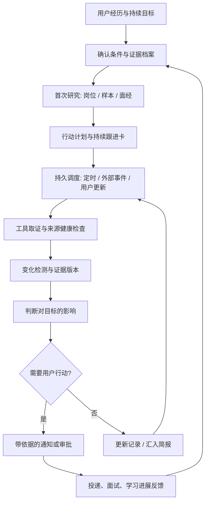

# 北极星完整应用场景调研：持续负责求职目标的云端个人 Agent

调研日期：2026-10-22，北京时间。依据：本轮用户场景、当前代码、只读本地数据、官方产品文档及 GitHub 源码。

本文是可审阅的产品与研发建议，不代表功能已经实现，也不替代 PURPOSE 的已确认研发顺序。没有启动持续监控、部署云服务、接管采集浏览器或发送消息。后续若采纳，先把本轮选中的目标和验收更新到 PURPOSE，再逐轮实施。

后续决定（2026-10-22）：用户确认第一阶段先交付本机可用版本。本文云端切片保留为后续研究方向；设备关机后持续运行不属于本机阶段验收。具体阶段边界以 [PURPOSE](../PURPOSE.md) 为准。

## 1. 这次用户要的产品是什么

用户向 Agent 交代教育、项目、实习和求职目标。Agent 整理出招聘视角的个人证据档案，研究目标岗位、可比较的求职经历、面经和团队动态，形成行动建议。用户随后委托它持续跟进：自己离线时，Agent 仍在云端检查目标与替代机会，发现变化、更新判断、准备下一步材料，并在需要时联系用户。

建议产品表述：**一个持续负责你求职目标的云端个人 Agent，把你的经历、岗位变化、可比较的求职样本和准备进展连接起来，让你知道现在值得争取什么、依据是什么、下一步做什么。**

最终目的仍是找到 LLM / Agent 实习，同时形成能被面试官核实的项目经历。产品侧强调持续的求职过程，技术侧以“带证据、条件和权限的长期任务执行”为主线。

这里有三项独立验收：第一次分析是否有用；过几天是否能根据变化继续工作；用户电脑关闭后是否仍能完成承诺范围。一次聊天演示只能覆盖第一项。

## 2. 这次实际调查的范围

| 证据层 | 本次做了什么 | 可以说明什么 |
|---|---|---|
| 用户需求 | 以背景抽取、横向对照、岗位/面经研究、持续云端跟进为主线 | 产品需求与设计目标 |
| 本地代码 | 核读 peers、tools/peers、memory、match、daemon、proactive、tasks、MCP 出口和数据模型 | 当前实现及缺口；未运行整条真实任务 |
| 本地数据 | 2026-10-22 14:51 左右，PostgreSQL repeatable read + READ ONLY；只做统计、选样和原文核对 | 现有数据是否足以支撑场景，不能证明全网情况 |
| 本地样本 | 按来源和结果选取 14 条记录，检查结构化证据及原文片段，重点核对实习类型、职能混淆和面经用途 | 发现具体问题；有目的抽样不估计总体错误率 |
| GitHub | 当前读取 7 个代表性仓库的 README，4 个求职项目进一步读取指定源码或测试；保存 blob SHA | 功能及机制参考；没有安装运行竞品或做性能排名 |
| 官方产品/工程文档 | Dots、Muse、LangGraph、MCP、Gmail 通知与 Anthropic 长任务研究 | 可核实的产品承诺、协议与工程机制；不等于北极星已有这些能力 |
| 公开求职内容 | 阅读可访问的牛客原帖；尝试小红书公开检索 | 用户问题的实例；帖子是自述，不能当招聘方统计 |

本轮插件检索没有返回可用的小红书插件，公开检索也没有取得足够可核对的小红书帖子正文。因此，小红书部分主要依据本机已经采到的原文，没有把搜索片段当作本轮新采集成果。一个牛客面经页只返回导航，小红书官网岗位页返回空正文，这两者均记为本轮无法核实，不能据此判定内容或岗位消失。

来源版本清单见 [sources.json](2026-10-22-continuous-career-agent-sources.json)，无原文聚合见 [data-audit.json](2026-10-22-continuous-career-agent-data-audit.json)。重算脚本及私有抽查材料在本机忽略目录 `data/probe/scenario_audit_20261022.py`、`scenario_20261022_private_samples.json`。

## 3. 完整的一次使用过程

以下人物、岗位和时间安排均为合成示例，不是作者的真实背景或实际招聘结论。

> “我是一名本科生，做过 Python 后端和 RAG 项目，想找北京或上海的 Agent 应用开发实习，可以连续实习四个月，每周四天。你看看我的经历有什么能拿出来讲的，哪些岗位值得投，和类似背景的人相比还差什么。未来两周帮我持续关注。”

### 3.1 首次交流：把经历整理成能核实的证据

先建立可修改的个人档案，并只追问会改变推荐的缺失信息。区别“用户说自己会”“有代码/报告支持”“经过实际验证”，不把未提供证明直接当作不会。

| 维度 | 需要整理的信息 | 产品输出 |
|---|---|---|
| 招聘资格与时间 | 在读阶段、毕业时间、专业、城市、到岗时间、每周天数、连续时长 | 哪些条件已知，哪些会造成硬冲突，哪些需要补问 |
| 经历 | 每段实习/项目的背景、本人职责、具体动作、结果、时间范围 | 一张可追问的经历卡，避免把团队整体成果算给个人 |
| 技术证据 | 仓库、提交、设计、测试、故障复盘、演示与测量条件 | “你做了什么”的证据链接与尚未证明的部分 |
| 求职偏好 | 职能、业务方向、地点、可接受条件、明确排除项 | 长期偏好与本次/本轮目标分别保存 |
| 当前进展 | 已投岗位、具体团队、面试轮次、回复与截止时间 | 按具体申请记录进度，同一公司多个岗位不串线 |

“HR 角度”宜拆成三个问题：是否满足明确资格；经历是否能清楚支持岗位要求；技术面试能否追问到真实工作。学校信息可以照录并与明确要求核对，但不以学校层次替代能力证据，也不虚构招聘方内部评分或筛选规则。

一次有用的反馈应类似：“你的 RAG 项目有检索与接口实现证据；尚未看到你如何处理失败和评估结果。目标 JD 强调任务执行可靠性，建议补一段可复现故障与恢复记录。实习时长符合；每周天数存在冲突，先核实。”

### 3.2 找岗位：建立目标与替代机会

围绕目标职能查官方 JD，再用可信来源补充团队、面经和实际工作内容。先区分 Agent 应用开发、算法/后训练、产品、运营，不能只因标题含 Agent 就合并推荐。

每个候选岗位输出：来源与核验时间、招聘类型、具体团队、明确要求、已知匹配证据、硬冲突、未知、建议动作。用“值得优先核实/准备”“明确条件不符”“信息不足”等标签，排序分只辅助安排精力。

“同层次公司”应由用户目标来定义：同职能、同招聘类型、相近职责深度、城市和时间可行性、业务偏好，以及用户明确的公司范围。知名度或规模可作为过滤条件，不能自动推导岗位质量、面试难度或成长价值。同一家公司的两个团队也可能很不同。

替代机会分开显示：满足原条件的替代岗位；需要用户接受某项变化的备选。后者明确标出变化，不擅自降低硬条件。

### 3.3 横向对照：建立可比较的公开经历样本

社交帖子通常无法证明谁在和用户竞争同一个 HC。产品宜称为“相似求职经历样本”，记录相似与不相似的维度。

优先级：同团队、同职能、同招聘季且同阶段的样本；其次同公司同职能同类型；再其次其他公司相近职责的样本。每次扩大范围都单独分组，并说明为什么扩大。没有足够同组样本时，保留缺口。

每条样本至少区分：自述主体、教育/经历事实、申请事件、岗位与职能、招聘类型、面试轮次、结果、事件日期、发帖日期、采集日期、出处。一个人多个 offer 属于多个申请事件；同一个人连续更新不重复当新的人。

对照输出建议为“你—JD—可比较样本—证据缺口—行动”五列。只有样本明确写出实习段数/论文数，才使用相应数值；没写保持未知。产品不输出个人录用概率，也不把样本中出现的经历称为统一录用门槛。

教育、项目与结果在帖子里可能来自作者、评论者或转述者，必须先明确主体。截图和评论可补信息，但 OCR 文本与归属也要核验。禁止从头像、昵称等推测人口属性；公开报告只放聚合与匿名化案例。

### 3.4 差距诊断：把“我还差什么”变成可执行任务

差距分为五类，结论来源分别展示：

| 类别 | 判断依据 | 适合的动作 |
|---|---|---|
| 明确资格冲突 | JD 明确条件与用户确认事实 | 核实是否有弹性，或选择符合条件的岗位 |
| 能力证据不足 | JD 要求对应的项目、结果、代码尚缺证明 | 补演示、测试、设计解释或可复现工程案例 |
| 经历表达不足 | 做过但职责、动作、结果不清楚 | 重写经历，保留原事实和证据；准备技术追问 |
| 面试准备不足 | 相关且归属清楚的亲历面经 + 用户练习表现 | 形成针对岗位的题目、追问和模拟练习 |
| 信息不足 | 用户未说、JD 未写、样本不足、来源不可读 | 最小补问或有限补查，不能直接变成能力差距 |

学习建议同时考虑重要性、可验证性、投入成本和投递窗口。例如“把现有项目做出断网恢复并记录结果”可能比“学完整个强化学习体系”更贴近某个应用研发岗位。具体选择仍应由当时 JD 与用户已有能力决定。

### 3.5 面试准备：岗位、经历与题目互相连接

按具体岗位制作准备包：岗位职责摘要；用户最相关的两段经历；与职责相关的面经题；针对本人项目的追问；需要核实的问题；面试前检查表。题目保留公司、职能、轮次、日期与亲历/整理资料标记。

候选人练习后记录“能否给出具体实现、设计理由、失败案例、证据和取舍”，不能只凭语言流畅度判定掌握。面试结束后接收用户复盘，用真实被问问题与明确反馈更新准备计划；未收到拒绝理由时，不推断一定因学校、论文或项目被拒。

### 3.6 开启持续委托：生成一张用户能看懂的跟进卡

跟进卡应包含：目标、当前条件、重点岗位与替代搜索范围、时间期限、来源覆盖、允许的动作、通知渠道与频率、预算、下一次检查时间、暂停/结束方式。

例如：“未来两周跟进这些 Agent 开发实习。重点岗位要求变化、明确关闭、匹配的新岗位、面试邀请立即提醒；普通新面经汇入晚间摘要。每日仅安排当前来源能力和预算允许的检查。每周四天是硬条件。消息与投递先展示草稿。”

用户授权的是明确范围内持续工作。随后每次常规只读检查可直接进行；目标范围扩大、敏感信息外发、实际投递等需遵守对应授权。暂停应停止未来调度，并说明已有在途工作状态。

### 3.7 持续执行：每天观察变化，再更新判断

需要分清三类进展：岗位公开状态变化；用户自己的申请进度；公司/团队公开动态。岗位仍在招不证明用户申请有进展，公司发布新模型不直接证明团队新增 HC。授权邮件或用户回填可以说明个人流程，社交讨论只能提供相应强度的线索。

### 3.8 一个星期的合成演示脚本

| 时点 | 新事件 | Agent 应做什么 | 用户看到什么 |
|---|---|---|---|
| 第一天 | 用户交代背景，给出项目链接 | 建证据档案，研究岗位和可比样本，保存基线 | 岗位清单、未知、优先行动、跟进卡 |
| 第二天上午 | 重点岗位要求从四天变为五天 | 对比字段与原文版本，按当前四天条件重新判断 | “出现到岗冲突”，附前后证据与核实建议 |
| 第二天下午 | 相近公司出现新岗位 | 校验职能/类型/硬条件，与已有岗位去重 | 值得查看的新机会及为何与原目标可比 |
| 第三天 | 原链接超时或出现登录墙 | 保存无法核验、最后成功时间，按来源规则有限重试 | 来源延迟提示；不能说岗位已关闭 |
| 第四天 | 新的相关面经出现 | 核对职能和日期，更新准备包 | 新增值得练的题及为何相关 |
| 第五天 | 授权邮箱出现面试邀请 | 匹配到具体申请，检查时间，准备日历草稿和面试包 | 面试提醒、冲突与需确认动作 |
| 第六天 | 用户完成故障恢复演示 | 读取新证据并更新能力档案、简历草稿 | 一项证据缺口已补齐；仍待准备的项目 |
| 第七天 | 一周结束 | 汇总新机会、变化、个人进展、未覆盖来源、预算 | 下周行动建议；继续、修改或结束跟进 |

演示需包含“无变化”和“一项来源故障”：无变化不重复同一结论，故障不冒充市场没有新机会。

## 4. 本地数据对这个场景的真实支持程度

本次非合成原文统计：小红书 604 条帖子、脉脉 1,179 条帖子、Boss 4 条岗位原文、腾讯官网 360 条、字节官网 343 条、小红书官网 46 条。它们是原文记录数，不能相加后称独立岗位数。

背景表共 560 条记录。按发布时间近 180 天筛出 468 条，现有启发式去重后 461 条，来自 367 篇帖子；“去重后记录”仍不等于已验证的独立自然人。

| 逐步筛选口径 | 记录数 | 解释 |
|---|---:|---|
| 近半年背景记录，现有去重后 | 461 | 所有职能、阶段与结果混合 |
| 目标团队/岗位/方向含 Agent、RAG、LLM、大模型、智能体或后训练 | 140 | 广义技术词命中，仍混有产品、运营、算法 |
| 其中含 Agent、RAG 或智能体 | 95 | 73 小红书、22 脉脉；不是纯应用研发队列 |
| 再要求类型明确为日常/暑期实习 | 20 | 13 小红书、7 脉脉 |
| 再要求本科阶段 | 2 | 两条都不能用来证明“本科拿 offer 的门槛” |

95 条中：学校字段存在 22 条，目标团队存在 18 条，实习经历列表非空 25 条；53 条招聘类型未说明、61 条阶段未说明。字段存在不代表内容已核验，也不代表有精确大学名称；“985/双非”等概括也会进入学校字段。

14 条抽查显示至少四个需要认真处理的问题：

1. **类型粒度。** 两条小红书原文明确说 Agent 实习，但没有说日常还是暑期，当前 `Person.job_type` 只能选日常、暑期、校招、社招或未说明，因而保留未说明。`peers_search(job_type="实习")` 却只匹配日常/暑期。问题在表示粒度与查询契约，不能仅责怪模型没抽出来。建议后续设计把“实习”主类型与未说明的子类型区分开。
2. **职能混合。** 数据包含 AI 产品、运营、后训练算法和应用开发。只用 Agent/大模型关键词横比会把不同人才要求混成一个门槛。样本分组需显式职能和职责证据。
3. **背景缺失。** 有的面经能支持“面试问了哪些工程问题、推进到哪一轮”，却没有学校或完整经历。它对准备有用，对履历横比的支持有限。
4. **事件和主体。** 一篇内容可能包含作者多个机会和评论者经历；现有去重对小红书作者主要使用账号+阶段+公司，没有完整区分岗位、招聘季与申请事件。新的比较必须避免把不同申请合并或把同一人多次计数。

本机一条本科日常实习面经记录，内容涉及中断恢复、旧上下文回读、并发状态、失败后继续和评测设计；另一条 Agent 面经涉及真实任务从输入到结果、人工确认、失败反馈和持久知识维护。这些是候选人自述的具体准备信号，能支持选择工程案例，不能推出所有公司必问或行业题目占比。私有原句和作者信息不写入本报告。

公开牛客的一个[求职选择原帖](https://www.nowcoder.com/discuss/879349992144568320)也同时呈现了已有经历、目标公司、收到的机会、时间冲突和是否继续准备的困惑。这支持把“机会选择＋时间约束＋准备行动”作为连续场景；帖子中的公司情况与结果属于作者自述，未独立核验。

**数据结论：当前足够制作有出处的初步研究和少量案例对照，尚不足以稳定生成细分同组竞争画像。** 下一步数据工作宜围绕一个明确队列补齐类型、主体、职能、日期和结果，而不是仅扩大总采集数。也不能从筛选只有两条推断平台上缺少这类人。

## 5. Dots、Muse 和 GitHub 对标意味着什么

Dots 官方文档明确描述持续负责、跨对话跟进、按变化安排后续、连接应用和云端电脑；云端工作可以在用户设备关闭时继续，本机工作则依赖本机在线。由此，北极星的对标验收应包括目标连续性、执行环境、变化响应和用户可控性。[官方说明](https://learn.chatgpt.com/docs/dots)

Muse 官方说明强调在专用云端环境中执行、关闭应用后继续工作、记忆和在需要批准时联系用户。其权限与审计设计是产品参考，本次未使用账号实测。[Meta 官方说明](https://about.fb.com/news/2026/09/introducing-muse-personal-ai-agent/)

| 项目 | 本次证据 | 可借鉴的部分 | 对北极星的边界 |
|---|---|---|---|
| [career-ops](https://github.com/career-ops-hq/career-ops) | README、reply-watch 模式与代码、patterns 模式、liveness-core 选段 | 从真实经历到岗位评估、材料、面试、回复和申请复盘；消息与状态变更需保留证据及去重 | 以本地求职工作流为主；未证明覆盖中国社交样本与长期云端责任 |
| [BossHunter](https://github.com/shengjidaguai-china/BossHunter) | README、Agent API 文档、采集状态测试 | 对话建档、窄工具接口、平台进度、重启后状态、人工确认 | 代码公开的非商业许可项目；借鉴机制，不能把源码存在当本机验证通过 |
| [OfferGraph](https://github.com/siyuansdsd/OfferGraph) | README、approval.py | 研究、简历 MCP、GitHub 项目证据、浏览器操作、明确审批结果 | 有组合式架构不代表已验证持续监控；auto-mode 可跳过该模块审批，不能照搬为统一安全保证 |
| [LinkedIn Job Alert Agent](https://github.com/sanchittanwar7/job-search-agent) | README、agent.js、store.js | cron→采集→过滤→模型判断→通知的简单闭环 | 适合作为定时推送基线。源码先 markSeen 后发送，且已知 URL 不复查内容变化；通知失败可能丢失常规重试机会，属于静态风险分析、未运行复现 |
| [JobSpy](https://github.com/speedyapply/JobSpy) | README 指定范围 | 多来源标准化输出，CLI/MCP 作为采集工具 | 采集库不负责用户长期目标、比较语义或通知状态；不采纳其中代理绕过等做法 |
| [changedetection.io](https://github.com/dgtlmoon/changedetection.io) | README 指定范围 | 页面差异、选定区域、变化通知；README 还区分部分托管 AI 功能 | 页面变化检测可作为基础参照；“对当前求职目标有什么影响”仍需领域判断 |
| [Deep Agents](https://github.com/langchain-ai/deepagents) | README 指定范围 | 规划、上下文、持久记忆、工具与审批等基础能力 | 与现有 LangGraph 技术栈相邻，不因对标而迁移框架 |

当前观察到的功能组合已经有不少同类实现。可以形成区别的是中国实习语义、可比较的证据、对具体目标的长期维护，以及真实使用中减少误判和遗漏的效果。本次没有做竞品运行或统一数据/模型对照，不能宣称胜出。

## 6. 持续云端运行需要哪些机制

### 6.1 保存“委托”，并让执行有状态

建议的概念对象：用户证据档案、求职目标、关注对象、来源观测、变化事件、版本化分析、行动/申请记录、通知记录。它们是设计讨论中的职责划分，不是已批准的新表或接口。

每个长期目标要保存条件版本、期限、允许动作、关注范围、来源覆盖、预算、最近成功检查、下一次检查、当前等待原因和结束依据。聊天记录保留原始决定；执行时读取最新有效版本，避免旧任务按已取消的条件继续通知。

一轮检查可处于排队、执行、等待重试、等待登录、等待用户、完成或失败。长期目标另有活跃、暂停、结束状态。一次检查完成不会把长期目标误标为完成；停止目标也不应该删除已保存证据。

LangGraph 的检查点与长期存储提供基础持久化，但应用仍需定义目标、外部动作与恢复规则。[持久化文档](https://docs.langchain.com/oss/python/langgraph/persistence)；长任务还需要每次执行留下可继续使用的进展材料，而不能只依赖对话摘要。[Anthropic 研究](https://www.anthropic.com/research/effective-harnesses-for-long-running-agents)

### 6.2 把高频变成“合适的检查频率”

高频的目的是及时发现重要变化。采集频率、模型分析频率和用户通知频率应独立控制。

| 对象 | 建议调度方式 | 注意点 |
|---|---|---|
| 少量重点官网岗位 | 在来源允许且稳定时，试验按小时级检查；临近截止可增加优先级 | 每次可先做轻量版本/字段检查，有变化再分析；具体频率需测量和来源约束 |
| 同职能新岗位发现 | 按招聘源更新节奏分批搜索，搜索预算与重点跟踪分开 | 已关注岗位轮询不能替代新机会发现 |
| 小红书/脉脉/Boss | 保留本人账号、来源配额、串行和阻断停止；按重要信息缺口安排查询 | 本轮不提高既有配额，不将每个目标乘成一套全平台高频抓取 |
| 邮箱/日历等授权应用 | 有事件通知则事件驱动，并设置补查 | Gmail 官方明确说明通知可能延迟或丢失，需要增量同步兜底 |
| 用户项目与能力变化 | 用户上传或指定仓库更新时触发检查 | 只有新增可信证据才修改相应判断 |
| 形势分析 | 日报/周报或重要变化触发 | 固定范围、时间窗和覆盖；无变化时不反复生成同一结论 |

上表是实验设计建议，不是已测出的最佳频率或服务承诺。Gmail 通知与历史游标可参考[官方指南](https://developers.google.com/workspace/gmail/api/guides/push)。

衡量延迟至少分成：等待采集、抓取、等待抽取、抽取、等待索引、索引、等待分析与通知。只把某个定时器从十分钟改为一分钟，并不能证明岗位更早被可靠发现。

### 6.3 识别语义变化，同时记录“没看见”

同一个 URL 文本改变可能是岗位要求更新，也可能只是页脚、推荐职位或登录提示变了。需要保留内容版本与字段证据，区分新岗位、同岗重发、要求调整、明确关闭、无法核验和无相关变化。

保存发布时间、事件时间、首次发现、最后看到、最后成功核验和处理完成时间；不互相冒用。连续抓取失败应显示覆盖下降，不能输出“市场没有变化”。某来源搜索结果减少，也可能是采集/索引变化，不能直接解释为就业形势变差。

### 6.4 通知必须能重试、去重和撤销旧判断

把“分析完成”“通知入队”“平台接受”“可获得时的送达回执”分别记录。面向重复调度与通知超时，使用目标版本和事件标识去重，避免重启后重复推送或因为过早标记 seen 而永久漏报。

每条通知说明：什么变了；与哪个目标有关；证据；对判断的影响；建议动作；仍未知的部分。一般变化入简报，临近截止、面试邀请、目标硬条件变化等按用户设置提醒。用户关闭某类通知后，下一轮立即遵守新偏好。

### 6.5 “完全云端”有明确验收门槛

2026-10-22 用户补充了现实约束：云端持续运行需要真实、可用且有人付费维护的运行环境，不能把规划或代码中的 daemon 说成已经上线。目标架构应让调度器、任务状态、分析、数据库、通知和已支持的工具执行都不依赖用户电脑开机。用户可在手机查看进展、处理确认、暂停或改目标。

一种实现是长期运行的云服务器；另一种是定时托管任务加持久数据库、队列和按需执行服务。后者未必需要一台 24 小时运行的虚拟机，但也需要云账号、持续可用的托管资源、费用和故障处理。高频检查、登录态浏览器、页面渲染和等待人工验证会影响选择。不能在未选型、未做离线测试时承诺 24 小时自动跟进。

公开官网和有正式授权方式的应用适合先验证云端执行。登录平台还需要可用的云端会话、登录/验证接管方式和平台允许的访问方式；网站可能阻止云浏览器。若某来源只能依靠本机采集，就应明确标为“依赖本机”，该来源还没有达到完全云端目标。

建议先交付完全云端可执行的来源子集，再逐个验证其他连接器。不要用“主 Agent 在云上”替代端到端离线验收，也不在本次研究中迁移浏览器登录态或真实原文。

部署前与用户共同敲定首批来源及登录平台边界、检查间隔和可接受延迟、通知渠道、月度费用上限、云账号及密钥归属、存储与备份、故障告警和维护责任、暂停方式及离线验收。用户没有在本轮选择云服务或授权采购/部署；这些均保留为待定。现有本机路线和本报告建议切片的关系以 PURPOSE 为准。

## 7. 需要连接哪些软件，为什么

| 软件/工具 | 读什么或做什么 | 对场景的贡献 | 第一个实现切片 |
|---|---|---|---|
| 招聘官网适配器 | JD、职位编号、状态和日期 | 机会及要求的主要证据 | 重点岗位读取和版本对照 |
| 小红书/脉脉内容工具 | 已授权范围内帖子、图片文本、评论 | 求职经历与面经案例 | 本地证据检索、主体与职能核对 |
| 简历/文档读取 | 用户提供的文件与补充经历 | 个人档案与材料 | 事实提取、缺失追问、证据绑定 |
| GitHub | 用户指定仓库、提交、测试和文档 | 验证项目经历与新增成果 | 只读项目证据报告 |
| 邮箱 | 用户授权的招聘相关邮件 | 个人申请进度与待办 | 区分邀请、拒信、营销邮件和未知 |
| 日历 | 用户可用时间、面试安排 | 避免冲突与准备提醒 | 时间冲突检查和待确认事件 |
| 通知渠道 | 用户指定的 App、邮件或消息渠道 | 离线时获得有价值变化 | 先做一个有回执/重试能力的渠道 |
| 岗位/申请工作台 | 记录、展示、确认、修改与暂停 | 人工可控及全程回看 | 一张持续目标卡和事件时间线 |

优先使用稳定 API/官方连接方式，再用适配器或 MCP 统一给 Agent；浏览器用于必要的网页交互。每个工具需要明确输入、输出、错误类别、时间、证据、权限和预算。MCP 的 schema 与错误结果提供标准接口，但不会自动解决账号授权、数据语义或通知可靠性。[MCP Tools](https://modelcontextprotocol.io/specification/2025-11-25/server/tools)

现有 `mcp_server.py` 是把北极星只读、非现查工具开放给外部客户端；它本身不意味着已经接入邮箱、日历或任意软件。软件数量不作为成果指标，每个连接器都要证明为目标贡献了可验证的信息或动作。

## 8. 现有北极星到目标之间的缺口

| 环节 | 当前已有 | 需要补齐的关键部分 |
|---|---|---|
| 个人经历理解 | 记忆抽取、历史、冲突、匹配条件 | 经历—本人贡献—产物—结果证据的组织；本次/长期/特定目标的条件版本 |
| 横向比较 | PeerProfile、peers_search、部分去重与未知提示 | 一般实习与子类型；职能/招聘季/团队可比性；主体、申请事件及字段级出处 |
| 岗位与面经 | 采集、抽取、合并、检索和来源卡片 | 稳定可用延迟；关注对象的语义变化与状态历史 |
| 主动性 | 常驻 daemon、规则决定 push/brief/drop、每日简报 | 用户可配置的长期目标、目标专属覆盖、下一次唤醒、变化影响分析 |
| 任务状态 | ChatTask 持久队列、同会话串行、取消与审批 | 日/周级责任的持续状态；进程重启后的分级恢复；目标版本与通知一致 |
| 结果通知 | 本地 Windows 通知、数据库记录与 Markdown 简报 | 云端渠道、送达状态、独立重试、去重及安静策略 |
| 外部软件 | 现有只读工具和 MCP 出口 | 经过验证的邮箱/日历/项目证据连接器及权限管理 |
| 云端 | Docker/启动基础，当前以本机为主 | 不依赖作者设备的完整运行环境和可观察的运维 |

目前的 `ChatTask` 在进程重启后会明确标记中断，不能称为所有任务自动续跑；`proactive/daily.py` 主要从近期候选中按全局画像决定通知，尚未形成每个长期目标独立维护的完整链路。本次代码检索未发现相应目标对象和完整云端通知投递状态机制；网页的本地 outbox 是聊天提交缓存，不能视为后端通知投递保障。

原先的来源可信性、可检索延迟、并发一致性和清理保护，都是这个场景的基础；但要把它们放回具体任务验收，避免一直只交付底层修复而没有用户能体验的完整一轮。

## 9. 最值得做深的方向、难点与证明方式

| 开发方向 | 真正难点 | 体现的能力 | 可展示证据 |
|---|---|---|---|
| 长期目标驱动的可靠执行 | 定时/事件/用户更新交错，重启、暂停、重复执行和旧目标失效 | Agent 编排、后端状态机、幂等、并发、恢复边界 | 一个跨天任务在故障与目标修改后仍正确继续的轨迹 |
| 时间与来源一致的证据管理 | 旧 JD、新要求、帖子事件时间、页面不可读不能混淆 | 数据工程、时序建模、证据检索和冲突处理 | 每个判断可回到当时来源，并展示为什么改变判断 |
| 可比样本与不确定性 | 缺失、选择偏差、职能混杂、同人多事件、作者/评论者串线 | 领域建模、结构化抽取、实体归属与评测 | 一组人工审过的比较案例，明确可比/不可比/不足 |
| 有价值的主动通知 | 抓到变化不等于有用；漏报、重复、旧条件误报与打扰 | 事件驱动产品、调度策略、用户反馈利用 | 按事件回放测有用提醒、重要变化遗漏和重复通知 |
| 受控软件执行 | 账号权限、令牌过期、工具失败、外部内容注入与副作用重放 | 工具契约、权限、连接器、可观测性 | 撤销授权、邮件误匹配、超时及重试的结果 |
| 证据到行动 | 从“缺某技能”到适合用户时间的准备任务，并验证完成 | 需求理解、任务规划、闭环产品设计 | 用户补充一个产物后，相关建议和材料确实改变 |

主线建议：**长期目标驱动的可靠任务编排**。领域深度放在**证据时效与可比样本**；上下文、检索、记忆围绕这两者的真实失败优化。图谱或多 Agent 可在证据显示需要时作为实现手段；本轮不把组件数量当创新性。

能在面试中讲清的故事应是：“以前某个岗位的加载失败被当成关闭，或者提醒在通知失败后被去重吞掉。我构造了反例，改了哪个状态/契约，怎样证明正常路径不退步，遇到无法恢复的情况如何如实告诉用户。”这比只列技术栈更能说明独立工程判断。

## 10. 建议的开发顺序与每轮完成标准

以下为本次研究提出的纵向切片，待选定后与 PURPOSE 当前轮次合并；不要求同时开发全部能力。

1. **先完成一个可核实的首次研究。** 固定一个合成用户、一个具体求职方向，产出经历证据、岗位、样本边界、准备建议和跟进预览。复用现有来源/检索；优先处理实习类型与条件一致性。完成标准：每个结论有依据，硬冲突不被分数抵消，未知保持未知，完整网页任务可复查。
2. **让这个目标跨时间继续。** 为少量重点岗位和替代搜索保存目标及条件版本，检测变化，支持暂停、期限和有界重试；先一个来源、一个通知渠道。完成标准：正常无变化、JD 更新、明确关闭、无法核验、用户改条件、重启和重复事件全部有确定结果。
3. **把通知变成行动。** 接入一个必要的软件连接器；邮箱优先用于个人申请进度，日历用于面试准备。完成标准：消息归属正确、未知不误写、用户确认流程可追踪、重复回调不重复创建事项。
4. **共同确定部署方案，再验证云端子集。** 先与用户确定云服务器或托管任务、费用、账号、首批来源与维护责任；用合成或明确授权的数据，在作者电脑关闭时持续运行已支持的范围，记录服务健康、来源缺口、预算和通知。完成标准：关机仍工作、重启不丢目标、连接器失效可见、用户能手机暂停；不能靠人工盯终端维持。
5. **用真实日常使用打磨。** 在用户授权的有限目标中持续体验，将漏报、误报、无效建议变成回归。对照同样数据下的简单定时规则和当前机制，报告原始次数与成本，不预先承诺录用收益。

对于个人开发者，第一个对外演示可限制为一个用户、一类目标、少量关注对象、一个外部渠道及合成案例。重点是核心任务全程真实工作，包括一次失败处理与一次用户改变目标。

## 11. 怎样验证场景，而不是只测模块

先准备 12–20 条任务/事件序列作为初始发现问题的规模，包含预留新需求。每轮只修改一个机制、固定数据/模型/时间/预算，必要时重复运行。它不是统计充分的 benchmark，也不预设通过率。

| 测试主题 | 必须观察的结果 |
|---|---|
| 初次背景不完整 | 只追问必要信息，未知不被补成事实 |
| 本次城市不同于长期偏好 | 工具、卡片、回答按本次目标一致，长期记忆不误改 |
| “实习”但子类型未知 | 保留已知主类型，不冒充日常或暑期 |
| 产品/算法/开发混合 | 不混成一组门槛；扩展组明确标注 |
| 同人多帖/多 offer | 不重复算独立候选人，不丢不同申请事件 |
| 加载页/登录墙/超时 | 无法核验，保留最近成功观测，不报告关闭 |
| 页面页脚变化 | 不生成岗位要求变化提醒 |
| 同 URL 真正更新 JD | 报出字段前后差异，重算目标影响 |
| 通知发送前/后进程退出 | 无静默丢失，重复投递受控，保存真实投递状态 |
| 用户修改/暂停目标 | 旧代任务不能按过期条件再通知或执行 |
| 邮件为广告/公司同时投多岗 | 不误报面试，不串到错误申请；歧义保留待确认 |
| 连续来源故障 | 覆盖不足可见，与“没有变化”区分，重试有上限 |
| 新能力证据到达 | 只更新受影响判断，能说明改变原因 |
| 完全离线客户端 | 云端继续，用户重新打开能看到完整进展 |

指标分四类：任务正确性（满足条件、证据支持、状态正确）；持续性（重启/去重/暂停/恢复）；主动价值（有用提醒、漏掉的重要事件、打扰次数）；成本与时效（实际可用和通知延迟、调用、token、来源访问量）。样本横比另测主体归属、类型、时间、可比性与未知表达。

离线回放用于控制事件真值和故障；真实运行用于验证平台、云环境、认证与送达。两者分开报告。用个人录用结果直接证明 Agent 有效会混入市场、经历与面试表现等因素，近期更适合测人工核查时间、找到的可用机会和实际行动完成情况。

## 12. 本次可以确定与仍待确认的事

已经有依据：持续负责的产品定位与 Dots/Muse 官方描述吻合；北极星有可复用的采集、记忆、检索、背景抽取和任务基础；本地可比数据远小于原始采集量；持久目标、变化分析、云端执行和可靠通知是独立缺口。

仍待后续真实任务确认：用户最需要的首个细分求职方向与比较维度；各来源可稳定支持的云端方式与频率；首次分析的实际有用性；持续通知的价值；完整链路成本。它们需要实验与使用反馈，不能从产品文档、源码或少量帖子直接得到。

建议首先评审第 3 节的完整场景和第 10 节的首个切片。具体数据库字段、接口、依赖和部署方案在选定切片后再出设计，避免研究阶段把所有候选方案直接实现。
