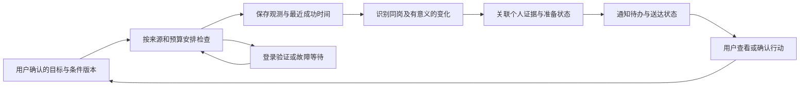

# 北极星开发前产品与实现调研（2026-10-22）

本报告响应“全面搜索开源与闭源相关产品，弄清开发方向和难度，避免闭门造车”。基于本机代码节点 `e6f8e6b` 及保留的工作区改动；旧报告是背景，本报告的当日复核优先。没有修改产品代码、采集、登录态或模型配置，没有采购云资源。

可审查材料：[来源与仓库版本](2026-10-22-product-landscape-sources.json)、[四条合成源码探针](2026-10-22-product-landscape-probe.json)。此前的[场景与数据审计](2026-10-22-continuous-career-agent-scenario.md)、[旧 GitHub 审计](2026-10-21-github-and-project-audit.md)继续保留，不冒充本轮新实验。

## 1. 结论与证据边界

**建议做“中国 LLM / Agent 实习的证据型求职工作台”，逐步验证一个具体求职目标的持续维护。** 岗位搜索、简历改写、AI 评分、申请看板和定时报告都有同类。仅把它们拼在聊天窗口里，没有证据支持竞争优势。可能形成价值的是：符合中国实习语义的筛选、经历与判断逐项有出处、岗位/申请/个人准备三种变化分清，以及持续使用中减少遗漏与错误。这里的价值仍是假设，必须让用户实际使用验证。

本轮覆盖 **11 个公开源码仓库（9 个开源、2 个受限源码项目）和 16 个商业、闭源或未确认开放源码的产品/站点**。另核对浏览器执行组件、公开招聘 API 与框架文档。11 个仓库固定 commit；其中9个仓库读取了26个实现/测试/设计文件的选定部分，其余以 README 和元数据为主。只实际执行 Reactive Resume 的一个纯函数、4条合成输入。

- **官方产品文档**能证明厂商公开描述的能力、部署与使用边界；不能证明真实用户效果或内部实现。
- **源码阅读**能核查选定路径如何设计；不能证明竞品完整系统已经在本机跑通。
- **局部探针**只证明该版本该函数在给定输入上的行为，不是竞品端到端评测。
- 没有登录或付费体验闭源竞品，没有注册云服务、读取用户邮箱、投递或联系任何人。宣传中的面试率、节省时间和用户量未独立验证，不参与选型排名。
- “全面”按需求链覆盖和代表性取样执行，不表示穷尽全网。搜索主题、候选、排除理由及链接见来源文件。

## 2. 闭源与商业产品：哪些能力已经有了

表中都是公开文档/页面证据，**不是账号实测通过**。涉及闭源算法、排序训练、去重、调度重试、通知保障等内部细节，未公开即保持未知。

| 产品与第一手来源 | 已公开描述的流程 | 对北极星的启示及未证实部分 |
|---|---|---|
| [Jobright Agent](https://jobright.ai/ai-agent) | 主动匹配、定制简历、申请自动化及求职计划 | 是直接竞争方向；“一直在线”和效果宣传不能当作其内部持久任务、送达和中国岗位覆盖的证明 |
| [Teal](https://www.tealhq.com/tool/resume-job-description-match) | 简历/JD对照、关键词和匹配分，配套岗位跟踪 | 学习按岗位组织材料与解释；不能把简历匹配分说成录用概率 |
| [Huntr](https://huntr.co/) | 岗位、联系人、面试和笔记管理，简历/求职信定制 | 学习完整求职记录与使用流程；不是只增加搜索结果列表 |
| [Simplify Job Matches](https://help.simplify.jobs/articles/2166608-using-your-job-matches) | 日更推荐、匹配原因、保存/隐藏/反馈及申请后跟踪 | 用户反馈、当前偏好与后续推荐必须连起来；推荐质量和内部学习机制未知 |
| [Jobscan](https://www.jobscan.co/) | ATS与关键词检查、材料与面试练习 | 简历检查已经成熟，第一阶段不宜自建另一套通用编辑器 |
| [超级简历 WonderCV](https://www.wondercv.com/?locale=zh-CN) | 中文简历诊断、JD定制、经历整理 | “HR视角”已有同类。其训练语料、通过率和措辞效果未独立验证 |
| [牛客 AI 模拟面试](https://www.nowcoder.com/interview/ai/index) | 不同题型练习、模拟面试与求职内容入口 | 北极星应优先把选中岗位和有来源的面经连接起来；不能把生成题当作真实面经 |
| [LinkedIn Premium Insights](https://www.linkedin.com/help/linkedin/answer/a563146/premium-insights-about-job-applicants-and-hiring-companies?lang=en) | 申请者技能、教育、经验和相对排名 | 依赖其平台数据；官方注明排名非招聘方认可，外站申请数据可能只是点击申请，不是完成申请 |
| [智联求职AI](https://ai.zhaopin.com/) | 岗位筛选、JD适配、计划、代聊、追踪、关键事项确认 | 国内平台也在做连续求职。页面同时存在内测预约，不能据页面判定所有账号已可用或跨平台都支持 |
| [offerin 公开工作台](https://www.modyzhang.com/) | 访客演示展示经历事实卡、岗位雷达、定向材料、准备与复盘 | 连“事实卡+准备+看板”也并非空白市场；后端质量、规模与源码开放状态未确认。与 offerin.cn 不是同一来源 |
| [Dots](https://learn.chatgpt.com/docs/dots) | 持续协作、上下文、跨应用工作和自有云端电脑 | 应借鉴目标连续性及需要用户决定时介入；不能用本机 daemon 等同其托管能力 |
| [Muse](https://about.fb.com/news/2026/09/introducing-muse-personal-ai-agent/) | 专用VM、跨应用、长期目标与权限控制 | 核心参考是实际执行环境与长期目标；本轮没有账号实测，不推断内部调度方案 |
| [Manus Automations](https://www.manus.im/features/automations) | 定时/事件触发、连接器与运行结果管理 | 持续执行是产品层能力，不只是循环调用聊天模型；内部可靠性实现未知 |
| [Claude Cowork 定时任务](https://support.claude.com/en/articles/13854387-schedule-recurring-tasks-in-claude-cowork) | 当前文档称新定时任务远程执行，并区分部分此前本机任务 | 不能沿用“Cowork一律必须开着电脑”的旧印象；新旧执行模式和可用范围要分别核实 |
| [Distill](https://distill.io/docs/web-monitor/cloud-local-monitors/) | 明确展示本机/云端监测、设备与检查位置 | 北极星也应明确每个来源在哪执行。云端管理界面不代表登录来源能在关机后检查 |
| [Visualping](https://help.visualping.io/en/articles/4440705) | 页面变化、AI重要性筛选与通知；另有[报告](https://help.visualping.io/en/articles/10899969) | 学习过滤噪声、变化历史和重要性判断；页面变化仍需转化为对求职目标的影响 |

补充区别：Simplify 的 [Copilot](https://help.simplify.jobs/en/help/articles/1749022-installing-and-setting-up-copilot)强调浏览器填表与本人审阅，而 [Autopilot](https://help.simplify.jobs/help/articles/1787280-applying-to-a-job-with-autopilot)仅在支持的申请系统/岗位上提供自动流程。不能把同一品牌的不同模式混成“所有岗位都能全自动”。北极星目前仍按本人确认、只读采集与人工投递的范围推进。

## 3. 开源与受限源码：真正能借鉴什么

许可证以本次查看版本为准，不因 README 使用“open source”字样就默认可复制。下表“学习机制”不构成复制代码或修改项目许可证的决定。

| 项目 | 许可/本轮证据 | 已看到的实现与适用边界 |
|---|---|---|
| [career-ops](https://github.com/career-ops-hq/career-ops) | MIT；README、reply-watch模式与匹配源码 | 从履历到评估、材料、研究和申请记录，邮件建议后由人确认；适合学习较少机会上的完整研究。依赖CLI工作流，不等于独立云端产品 |
| [JobOps](https://github.com/DaKheera47/job-ops) | 当前为AGPL加Commons Clause限制，按受限源码研究；6个选定文件 | 采集/评分流水线、Gmail路由、跟踪、关注公司与自托管；最值得看数据处理与申请事件。不可因可自托管就按宽松开源代码直接引入 |
| [BossHunter](https://github.com/shengjidaguai-china/BossHunter) | PolyForm Noncommercial；README、采集状态测试 | 国内多平台、人工确认、采集断点与回复流程；只借鉴状态管理和边界，不沿用发送策略或平台绕过做法。测试本轮未运行 |
| [OfferGraph](https://github.com/siyuansdsd/OfferGraph) | Apache-2.0；当前README，旧报告已有approval源码 | LangGraph、研究、简历MCP、浏览器及审批组合。结构类似，但“多Agent+MCP”不自动带来可恢复性；本轮未重跑旧源码或完整服务 |
| [OfferPilot](https://github.com/offercontext/offerPilot) | AGPL-3.0；4个设计/源码文件 | 本地优先的投递、材料、模拟与Offer管理；写入确认、证据和回执已有具体机制。当前Windows包和真实邮箱接入均有实验边界；直接复用需先审查许可 |
| [Reactive Resume](https://github.com/reactive-resume/reactive-resume) | MIT；README、匹配与时间工具；4条纯函数探针 | 当前已不仅是简历编辑：还含申请跟踪、面试、跟进与材料管理。部分匹配辅助是词法规则，不能当作中文实习资格模型 |
| [JobSpy](https://github.com/speedyapply/JobSpy) | MIT；当前README与元数据 | 统一多招聘源字段，适合作为适配层参照；不负责个人目标、证据比较、通知送达或中国平台长期登录 |
| [changedetection.io](https://github.com/dgtlmoon/changedetection.io) | Apache-2.0；README、通知服务 | 选定区域、历史快照、差异与通知；当前README还描述自托管LLM支持，不能把旧版托管AI边界泛化到当日版本。页面diff不是招聘状态或录用判断 |
| [Deep Agents](https://github.com/langchain-ai/deepagents) | MIT；README、summarization源码选段 | 历史外置、压缩、回读和运行基础；与现有LangGraph相邻，应按失败借鉴，不为换框架重写产品 |
| [Hermes Agent](https://github.com/NousResearch/hermes-agent) | MIT；cron调度、任务、执行账本、送达队列选段 | 持久执行记录、运行归属、消息队列和不确定送达处理；通用长期Agent，不含中国求职领域语义 |
| [OpenClaw](https://github.com/openclaw/openclaw) | MIT；cron文档、送达实现、类型及重启测试源码 | 执行结果与送达结果分开、运行隔离、失败事件和恢复边界；是机制参考，不能把其庞大运行平台整体搬进个人项目 |

### 3.1 六个值得转成开发决策的实现发现

**① 经历/岗位事实先于评价。** JobOps 的 [scorer.ts](https://github.com/DaKheera47/job-ops/blob/4a5e52b76a729aa2f57e4e9171216cf9621140a0/orchestrator/src/server/services/scorer.ts)把岗位事实复核、客观岗位简报与候选人评价分开，并要求修正字段附原文证据。OfferPilot 的 [evidence_policy.py](https://github.com/offercontext/offerPilot/blob/0452e47edd6c6a825e032c4c25719bb7a2c7bf26/src/offerpilot/knowledge/evidence_policy.py)和[设计决策](https://github.com/offercontext/offerPilot/blob/0452e47edd6c6a825e032c4c25719bb7a2c7bf26/docs/architecture/decisions/0004-evidence-deterministic-filter-and-provenance.md)保留原件，过滤索引噪声并记录策略版本。北极星应继续保留原文和字段来源，让“岗位要求”“本人已证实经历”“尚未证明的能力”可以逐项对照；不能让生成的推荐理由反过来成为事实。

**② 状态更新需要识别主体、版本与确认结果。** career-ops 的 [reply-watch](https://github.com/career-ops-hq/career-ops/blob/dff9703a092e2872245aef09b096edcee054ac69/modes/reply-watch.md)先提出邮件对应的申请变更，再确认；[reply-matcher](https://github.com/career-ops-hq/career-ops/blob/dff9703a092e2872245aef09b096edcee054ac69/reply-matcher.mjs)处理公司名、短词误匹配和歧义。OfferPilot 的 [review.py](https://github.com/offercontext/offerPilot/blob/0452e47edd6c6a825e032c4c25719bb7a2c7bf26/src/offerpilot/job_mail/review.py)在事务中写事件、建议状态和回执，并复核原文/范围/版本。北极星可学习“证据→建议→用户确认→事务→回执”，不先增加邮箱或自动投递。

**③ 自动同步与自动替用户决定是两回事。** JobOps 的 [Gmail同步](https://github.com/DaKheera47/job-ops/blob/4a5e52b76a729aa2f57e4e9171216cf9621140a0/orchestrator/src/server/services/post-application/ingestion/gmail-sync.ts)按外部消息ID复用已有分类，一些自动关联会触发申请阶段事件；这显示一条可实现的自动路径，但不是北极星现有授权。重复邮件、同公司多岗位、改期和拒信归属都要单独验证，不能只接一个邮箱MCP就宣布完成跟进。

**④ 完成执行不等于通知到人。** Hermes 的 [delivery_queue.py](https://github.com/NousResearch/hermes-agent/blob/8237c7f8ec179c88857f24a174509d985af704b7/cron/delivery_queue.py)使用持久队列和pending/delivering/delivered/failed/unknown等状态，发送前原子领取；[executions.py](https://github.com/NousResearch/hermes-agent/blob/8237c7f8ec179c88857f24a174509d985af704b7/cron/executions.py)另存执行状态。OpenClaw 的[送达实现](https://github.com/openclaw/openclaw/blob/47e115ebf762298e12166e9b12b6a061bd4d2626/src/cron/delivery.ts)在尝试前复核运行权限，其[送达契约](https://github.com/openclaw/openclaw/blob/47e115ebf762298e12166e9b12b6a061bd4d2626/docs/automation/cron-jobs/delivery.md)区别确定未送达与可能已送达的未知，不盲目重发后者。本轮只静态阅读，未验证其所有故障分支；北极星也不能轻率承诺外部副作用“恰好一次”。

**⑤ 持久化与恢复要分开验收。** [Deep Agents压缩实现](https://github.com/langchain-ai/deepagents/blob/b4ac8829692785a221150658401ae558f4bff3f3/libs/deepagents/deepagents/middleware/summarization.py)会外置历史供后续取回；[LangGraph官方文档](https://docs.langchain.com/oss/python/langgraph/persistence)区分线程checkpointer与跨线程store。北极星已有这些基础，仍需检验中断点、重复副作用、取消后的迟到结果及旧证据回读，不应把“数据库有聊天”称为自动续跑。

**⑥ 窗口、会话和执行位置是产品能力的一部分。** [Dots连接文档](https://learn.chatgpt.com/docs/dots/computers-and-apps)明确本机任务依赖本机在线，云端与本机网站会话不同。Distill也明确区分设备。这支持本机先行、以后按来源评估云端的路线；保存Cookie并不保证服务端认证持续有效。

## 4. 实际执行的源码探针：不能直接照搬通用匹配

执行对象为固定版本[matching.ts](https://github.com/reactive-resume/reactive-resume/blob/2559c42c7a9e9d8d42bc92143b8671d0419ea642/packages/api/src/features/career/matching.ts)中的 `matchOpportunity`。原文件经现有TypeScript编译，在没有 `require/process` 的VM上下文中调用，输入均为合成数据；没有启动竞品、调用模型或访问招聘平台。

| 输入/目的 | 实际结果 | 可得出的结论 |
|---|---|---|
| 英语RAG岗位、上海、明确办公方式和薪资 | 命中RAG/Shanghai，未知项为空 | 正常对照能按该函数规则工作 |
| 只有“服务10,000用户”，没有薪资 | 没有报告薪资未知 | 数字形状启发式会把无关数字当薪资信号 |
| 明确写Python不是必需 | 仍返回Python词语命中 | 词语出现不等于岗位要求成立，更不能直接代表资格满足 |
| 中文“检索增强生成”、线下、每天300元，对比RAG/上海 | 仅命中上海，薪资/办公方式未知 | 不能默认英语词法规则覆盖中文同义词和薪资表达 |

这不是“Reactive Resume整体不行”的证据：该函数本来就是词法辅助，其他产品路径和模型没有测试。对北极星的工程要求是：中文领域归一化、否定/必须/优先语义、事实未知和硬条件核对，必须独立于展示分数验证。JSON包含commit、文件摘要、方法、所有输入输出；本机复现实验在忽略目录 `data/probe/landscape-20261022/`。恢复环境可按JSON固定commit取原文件，使用项目现有TypeScript执行同样4个输入；不必安装整个竞品。

## 5. 把用户场景拆成真正的产品过程

下面是**建议的目标流程**，不是已实现能力清单或新表设计。

| 步骤 | 用户看到的结果 | 系统必须做的事 | 最容易糊弄的错误 |
|---|---|---|---|
| 讲经历/导入材料 | 可核对的学历、项目、职责、结果及缺项 | 事实与原句、有效时间、用户修正关联；临时条件与长期背景分开 | 编造指标，把“没写”变成“没有” |
| 明确本次目标 | 方向、岗位类型、地点、天数、时间等本次条件 | 从已确认资料读取，缺失保留未知；有歧义再问 | 用旧城市覆盖这次城市 |
| 研究机会 | 岗位列表及来源、最近成功核查、匹配/冲突/未知 | 数据可用性、同岗合并、时效、预算与失败分类 | 网络失败说已下线；匹配分冒充胜率 |
| 比较相似经历 | 样本条数、队列条件、出处、缺失项、不同背景 | 识别主体、岗位职能、招聘季与结果；保留自述性质 | 将在职履历、发帖人和该岗申请者混成竞争池 |
| 分析差距 | 每项要求对应经历证据、缺失证据和可执行准备 | 区分硬门槛、优先项、材料表达不足与能力不足 | 没检索到项目就断言不会 |
| 准备面试 | 指定岗位、带出处面经及另标生成练习题 | 公司/团队/职能/时间归属，题目去重与用户复盘 | 通用八股题包装成该团队真题 |
| 开始本机跟进 | 关注范围、频率、最近成功、下次检查、等待原因 | 目标可暂停/修改；观测、变化和通知分别保存 | 不断重跑同一prompt，却不保存目标和变化 |
| 报告变化与行动 | 哪些变了、影响什么、依据与建议下一步 | 新旧版本对照；重复事件去重；投递状态只由相应证据更新 | 岗位关闭推断用户被拒；没变化也反复通知 |

例如用户准备Agent/RAG工程实习：系统先按本人已确认条件查岗位，给出逐项证据对照；随后对选中的一个岗位组织准备和跟进。城市/出勤天数未知时不代填。不能仅因用户给了“HR视角”四个字就扩大收集个人主页或预测录用。

### 三类比较必须分清

1. **岗位要求对本人证据**：数据相对可获得，应优先做深。
2. **公开自述案例对本人**：可做探索性案例对照，明确时间、分母、缺失与自述；不能推出真实投递者分布。
3. **同一岗位真实申请池排名/胜率**：需要相应完整、有效且有权使用的数据。当前没有这些数据；不能承诺靠爬帖子解决，也不应伪造百分位。

当前[私有数据的聚合审计](2026-10-22-continuous-career-agent-scenario.md)已说明实习细分类型、背景和主体稀疏。更换模型不能自动补出不存在的学校、经历或录用标签。

## 6. 真正的难点与工程方向

难度表示实现与验收复杂性，**不是“接API需要几小时”的估算**。S为主要单模块；M需要跨层一致；L需要故障/并发/真实环境长期验证；XL还受外部数据或基础设施制约。

| 能力 | 难度 | 难在哪里 | 北极星下一步的验证 |
|---|---|---|---|
| 经历结构化与证据回指 | M | 指代、职责边界、时间和本人确认；生成改写不能覆盖原事实 | 原话/导入→结构字段→修正→跨对话仍一致 |
| 中文实习条件与资格解释 | M–L | 日常/暑期/校招、未知、学历与出勤；本次条件贯穿工具/回答/卡片 | 北京长期偏好/本次上海、未知天数、硬冲突、同义改写 |
| 多来源采集与新鲜度 | L | 会话、平台变更、页面加载、部分失败、来源覆盖 | 每源最近成功/错误；无需新增也能处理旧待办；保持既有配额 |
| 同岗实体与语义变化 | L | 同岗位跨站重发、标题微调、招聘季、错误合并 | 同岗版本对照；噪声变化不通知；要求/截止变化有原句 |
| 有依据的面试准备与差距 | M–L | 面经归属不完整，资料自述，建议需要映射到个人证据 | 选中岗位→引用→练习→用户复盘，不把生成内容说成事实 |
| 一个本机目标持续跟进 | L | 条件版本、暂停、断电补查、重试预算、过期结果 | 目标修改后旧执行不再继续通知；重启不丢必要状态 |
| 邮箱/日历与申请状态 | L | OAuth、同公司多申请、时区改期、重复邮件和写入确认 | 先人工粘贴及待审建议，再讨论一个连接器；重复确认不重复写 |
| 通知与恢复 | L | 发送前后崩溃、结果未知、重复和丢失的取舍 | 区分待发/已尝试/确认成功/失败/未知，保存回执 |
| 真实竞争池比较/录用概率 | XL/当前数据阻塞 | 缺真实申请池和可靠结果标签；选择偏差无法靠提示词消除 | 先验证病例可比性；数据不支持就拒绝排名 |
| 关机后、多用户的云端持续服务 | XL | 实际执行环境、用户隔离、凭证、存储、队列、账单和运维 | 另行部署评审及本机关机验收，不能以本机测试替代 |

多数模块可先做演示；做成连续可靠的产品，工作主要在数据质量、边界、一致性与故障恢复。现阶段不给整套功能承诺精确日期：外部认证、模型403与数据获取会阻塞验收。第一轮记录实际工作量后，才用已有证据估算后续排期。

## 7. 对本机代码的新核对：有基础，也有具体缺口

下列结论基于选定源码静态检查。不是新的全库健康检查，没有重启后台或改真实数据。

| 本机位置 | 已有基础 | 缺口与后果 |
|---|---|---|
| `agent/tasks.py:131` | 持久任务、同会话串行、恢复时检查审批 | 重启把running转waiting_approval或interrupted；不是全部任务自动续跑 |
| `proactive/daily.py:43,66` | 从长期记忆构建画像，挑近期岗位/帖子和截止事件 | 主要是全局画像推送，不是每个关注目标独立维护条件版本和语义变化 |
| `proactive/daily.py:125–136` + `logins.py:notify` | 通知历史、去重与桌面提示 | **先提交push记录再调用发送，发送函数又吞掉异常。** 静态上可能记为推过但未实际送达；尚未隔离复现，不说已经发生真实漏报 |
| `tools/peers.py:61–105` | 自述证据、样本、日期和去重 | 实习只包含两个细分类；宽泛未说明类型可能漏出队列，去重也未完整区分岗位与申请事件。旧数据问题仍待限定队列验证 |
| `match.py:125–136` | 硬冲突限分、未知与提示，分数明确非录用概率 | 启发式分数不能替代领域要求和事实对照；前后端现有条件改动仍需完整任务核验 |
| `search/maintenance.py` 等已有链路 | 持久知识待办、有限重试与实际索引恢复已有证据 | 部分真实新岗位命中不等于所有新增及时可用，延迟与失败项仍需测量 |

通知风险是本轮新增的、能对应产品体验的研究发现。建议在进入持续跟进切片时先做隔离失败注入，确认影响后再设计最小修复；当前不插队重写通知或给真实用户发试验消息。

## 8. 实现路线：保留什么、复用什么、以后再定什么

### 保留现有基础

保留现有 FastAPI、PostgreSQL/pgvector、LangGraph、前端、来源适配器、字段证据与运行记录。继续维护已有条件、记忆与知识队列。没有证据支持迁移整个项目到OpenClaw、Hermes、Deep Agents或引入第二套编排平台；它们的价值在机制和反例，不在名字。

### 优先学习并自行实现适合本项目的机制

- career-ops/OfferPilot：按机会组织上下文，写入建议与本人确认，原文、版本与回执关联。
- JobOps：客观岗位事实与候选人评价分开，外部ID去重，按来源组织处理流水线。
- changedetection/Distill/Visualping：明确检查位置，保存快照，过滤页面噪声，以变化而非重复全文驱动分析。
- Hermes/OpenClaw：执行账本与送达账本分开；明确取消、过期、失败和未知，避免旧任务继续发出结果。
- Deep Agents/LangGraph：已有上下文按需外置和回读；不把长期记忆、图检查点和业务目标混为一个对象。

### 暂不优先扩展

通用简历排版器、批量自动投递/代聊、全平台个人主页采集、假定能绕过登录限制的云浏览器、无限多Agent、复杂图谱，以及“战胜多少申请者”的百分位模型，均不是本机首版的必要交付。本轮没有批准新接口、表、依赖或部署。

公开数据可优先参考稳定的官方招聘源：[Greenhouse Job Board GET无需认证](https://docs.greenhouse.io/job-board)、[Ashby公开岗位API](https://developers.ashbyhq.com/docs/public-job-posting-api)、[Lever公开职位接口](https://github.com/lever/postings-api)。这说明未来可以先验证适合云端执行的来源子集，**不表示这些ATS覆盖中国实习目标，也不改变当前先不扩平台的顺序**。接入前仍需验证目标覆盖、接口条款、字段与频率。

Browser Use和Skyvern可作会话/浏览器执行组件参照；[Browser Use的Cloud说明](https://github.com/browser-use/browser-use/blob/main/CLOUD.md)也区分会话与持久profile。它们不能代替平台允许访问的前提，当前没有接入、上传Cookie或采纳规避平台验证的功能。

## 9. 第一阶段开发顺序与验收门槛

本轮补充研究不抹掉已完成工作，也不自动批准“关注目标”等新增数据结构。继续以PURPOSE维护唯一顺序，下面把竞品证据转成具体交付。

| 顺序 | 用户可见交付 | 验收门槛 |
|---|---|---|
| A：先完成已有数据可用性小步 | 新岗位确实可查，失败与等待能解释 | 测原文→结构化→关键词→向量的真实等待及未成功项；采集/知识处理失败分别记录；复用已有保护，不重做已通过机制 |
| B：完成本次条件和证据对照 | 用户讲经历后，对同一批岗位看见符合/冲突/未知及出处 | 工具、回答、卡片条件一致；已确认背景不被本次搜索改写；未知不填充；空结果原因有据 |
| C：完成一次连续求职任务 | 选定岗位→有依据的差距与面试准备→本人确认保存跟进 | 岗位实体不漂移，真实面经与生成练习分开，保存后可重新读取；在正常、未知、故障场景均执行 |
| D：评审一个目标的本机持续跟进 | 可看最近检查、重要变化和下一步，可暂停/修改 | 先提出职责/接口方案；限定一个方向、现有来源和预算；验证版本变化、重启、失败、去重及送达 |
| E：独立交付与后续云端选择 | 可照说明启动的合成演示和工程案例；云端另议 | 不包含真实原文/账号；公开说明与实测一致；云端按选定来源/成本/运维再验收 |

B/C必须有真实网页任务，不能只给pytest计数。网页对话目前仍受原服务403影响，采集的临时百炼许可不自动扩成网页模型切换；先准备独立可运行的验证，模型选择另给具体方案。不能用假模型把真实对话标成通过。

D不是“设置一个每小时执行的prompt”就完成。建议的职责链如下，属于待评审方案：

## 10. 部署与成本：不能用产品宣传替代运行安排

本机第一阶段依赖电脑在线、执行进程和有效会话；关机后不能继续本机来源。后续云端必须共同确定执行位置、数据库、调度、网络、通知与运维责任。Dots/Muse是厂商提供实际云端执行环境，购买某个模型API或连接MCP并不会自动获得相同能力。

成本应拆成：执行环境运行/启动成本、浏览器时长、持久数据库/对象存储、模型输入输出和重试、通知投递、备份与维护。自托管开源不等于零成本；本报告不引用仓库中低价VPS宣传作为你的预算。

**频率示例仅用于算量，不是平台允许额度：** 假设10个目标、3个来源、全天每2小时检查一遍，逐目标逐来源朴素做法是每天360次来源检查；改为每5分钟一次就是8,640次，24倍。详情、分页和失败重试还会增加调用。应尽量按共享来源取增量、先做确定性去重/变化识别，仅在相关变化时做模型分析，并受实际来源配额限制。不要把全天常驻推理当成持续跟进的必要实现。

部署讨论的最小清单：哪些来源必须关机后可用；其访问方式与会话是否支持；频率/延迟；模型与浏览器月度预算；通知渠道与打扰上限；账号归属、备份与故障处理；暂停/撤回方式。当前未选择供应商、未询价采购、未迁移真实数据。

## 11. 怎样证明开发有价值

不以竞品功能数、stars或一次流畅演示验收。按固定条件比较：

1. 任务正确：硬条件冲突是否遗漏，未知是否乱填，出处是否支持结论。
2. 数据与时效：各来源覆盖、最后成功时间、入库至关键词/向量可用等待，失败项不隐去。
3. 连续性：本次条件是否贯穿、跟进是否实际保存、暂停和重启后是否正确。
4. 主动价值：重要变化漏报、误报/重复提醒、用户是否据此采取行动；先积累有分母的本机样本。
5. 成本：来源调用、模型调用/token、失败重试和处理耗时；价格不完整时不伪报总费用。
6. 比较边界：相似经历只按可比队列陈列，录用概率和平台排名当前不提供。

每轮保留正常对照、已复现反例和未用于调试的新表达。最先要证明的是“帮这个用户正确完成一轮求职任务”，再证明长期跟进值得持续使用，最后讨论扩平台和云端运营。

## 12. 调研后明确的决策与待定项

**已确认且继续执行：** 本机首版；跨编程软件靠项目文件接续；本人账号、只读、有限预算和平台验证停下；不编造经历与岗位；既有完整任务路线。

**本轮研究建议：** 加深经历/岗位事实对照，把持续跟进落实为目标版本、观测、变化、行动和通知的职责；将通知送达风险、同岗变化与比较数据质量列为后续设计输入；从成熟实现学习而不迁移整套框架。

**仍待用户与实际验证确定：** 新的业务结构和接口、首个本机关注目标切片、邮箱/日历接入、网页对话模型处理、云端范围与预算。闭源内部架构和真实效果保持未知；本轮不宣称北极星优于这些产品。
